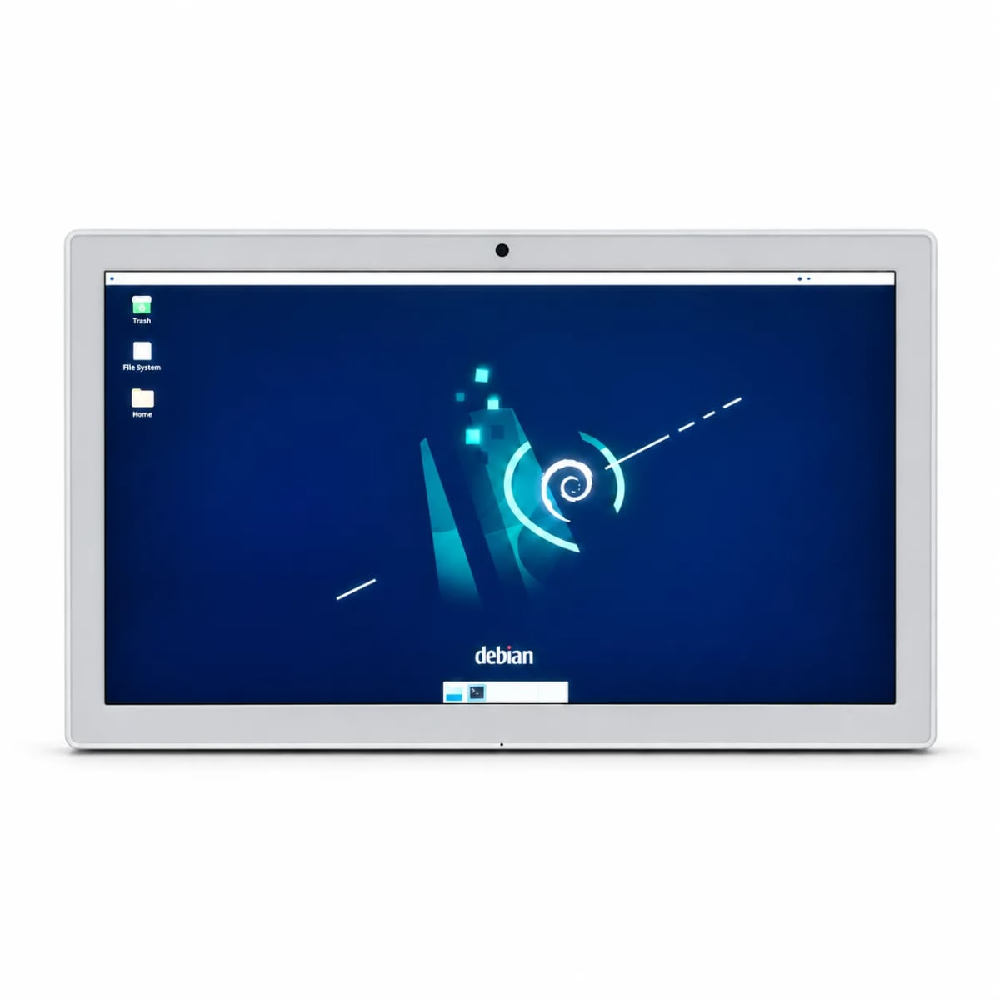
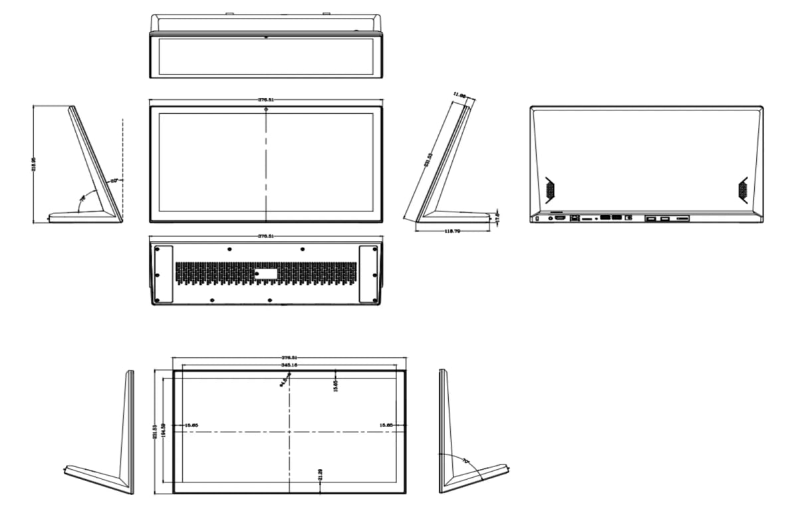
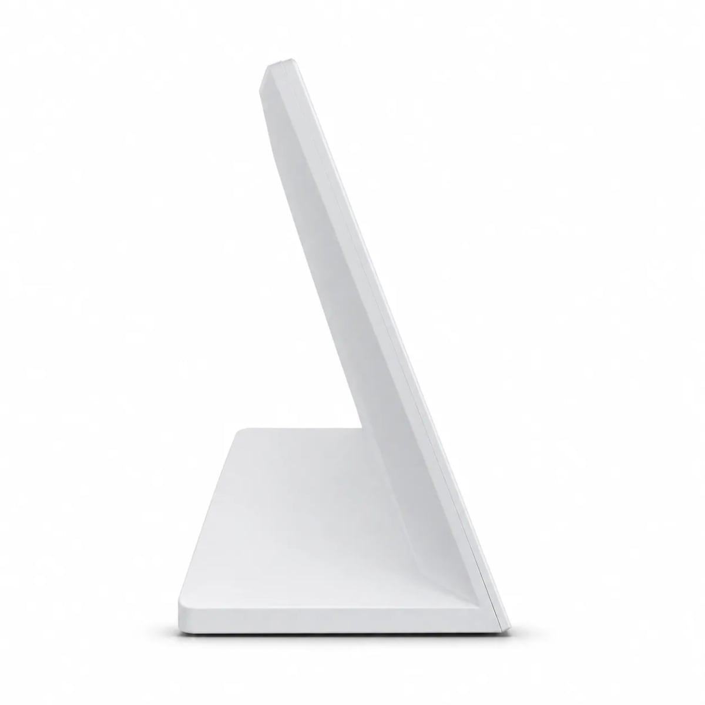
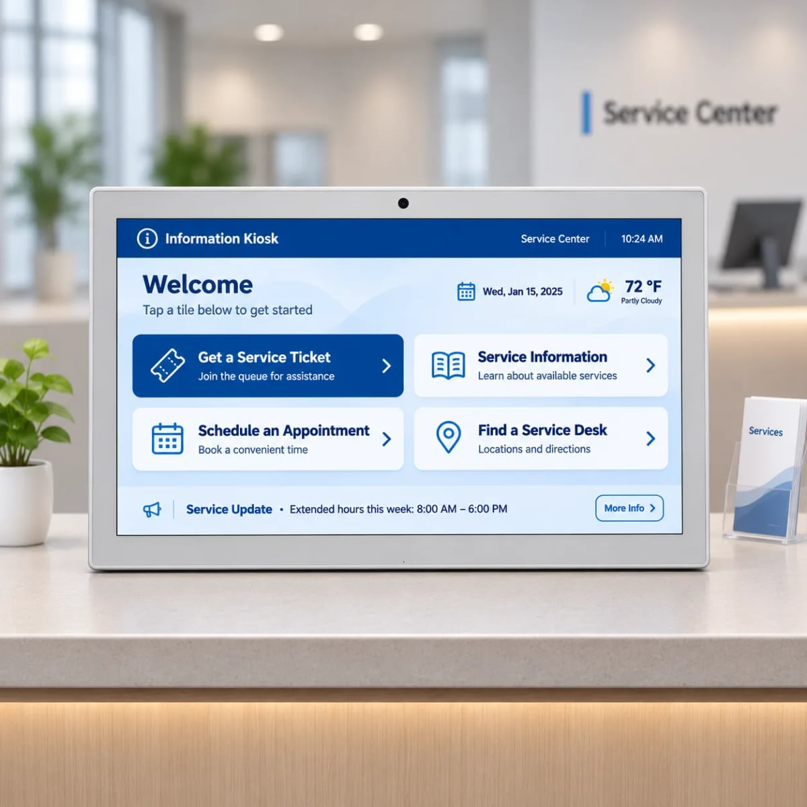
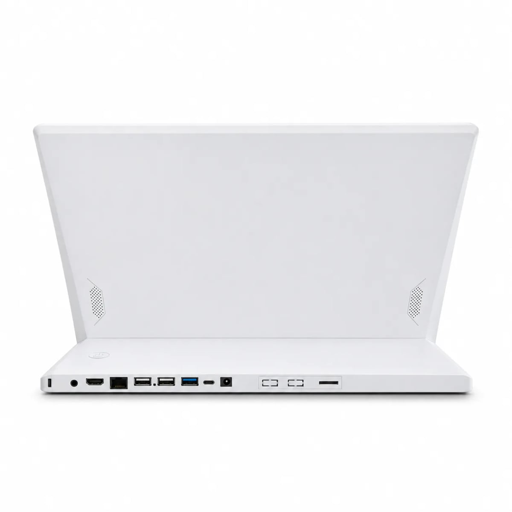

# HYY-L156T-3588 15.6-Inch Countertop Touch Kiosk with Rockchip RK3588

> Model: **HYY-L156T-3588** · Brand: EELLNET · [View on the official website](https://www.demo-furniture.test/products/interactive-kiosk/hyy-l156t-3588-countertop-touch-kiosk?utm_source=github&utm_medium=referral&utm_campaign=products)

The HYY-L156T-3588 is a 15.6-inch countertop touch kiosk built on a Rockchip RK3588 octa-core processor with 8G memory, 128G storage and Linux. Its 1920×1080 panel, capacitive touch and full port row make it a practical unit for retail and quick-service counters, and the platform is available with OEM/ODM customization for project orders.

## Highlights

- **RK3588 octa-core platform** — Rockchip RK3588 with a 64-bit big.LITTLE layout (4× Cortex-A76 + 4× Cortex-A55), paired with 8G memory and 128G storage on Linux.
- **15.6-inch 1920×1080 touch panel** — A 16:9 panel at 1920×1080 with capacitive touch, 300 nits brightness, 1000:1 contrast and 85/85/85/85 viewing angles.
- **Ports for peripherals and wired networking** — HDMI×1, USB2.0×1, USB3.0×1, RJ45×1, 3.5mm audio×1, TF×1 and a DC input, powered by a 12V/2A supply.
- **Desktop placement with a VESA pattern** — Sits on a counter as a desktop unit, and the rear carries a 75×75 mm VESA pattern for fixture design.
- **OEM/ODM customization** — Mainboard, chip, storage, memory, touch and speakers can be configured; housing color and size, operating system, boot logo, packaging and logo printing can be customized. Minimum order quantity is 1 unit.
- **Tested before every shipment** — Each unit is checked with a dedicated test app and put through more than 4 hours of stress testing before it leaves the line.

## Specifications

| Parameter | Value |
|---|---|
| Screen Size | 15.6 inch |
| Resolution | 1920×1080 |
| Aspect Ratio | 16:9 |
| Brightness | 300 nits |
| Contrast Ratio | 1000:1 |
| Viewing Angle | 85/85/85/85(L/R/U/D) ° |
| Touch Type | Capacitive Touch |
| Operating System | Linux |
| CPU | Rockchip RK3588, octa-core 64-bit big.LITTLE architecture: 4x Cortex-A76 + 4x Cortex-A55 |
| Memory (RAM) | 8G |
| Storage | 128G |
| Speakers | 2×2W |
| Interfaces | HDMI×1, USB2.0×1, USB3.0×1, RJ45×1, 3.5mm耳机×1, TF×1, DC电源口×1 |
| Power Supply | 12V/2A |
| VESA Mount | 75×75 mm |
| Installation | Desktop |
| Operating Temperature | 0~50 ℃ |

## Use Cases

- **Retail counters** — Stand the unit on a checkout or service counter to run promotions, product details and store information on a 15.6-inch screen. Capacitive touch lets staff or shoppers step through pages directly, and the 2×2W speakers carry short video with sound.
- **Quick-service restaurant (QSR) counters** — At the order counter the display shows combos, daily offers and counter messages on a 1920×1080 panel that stays legible at close range. The RK3588 platform and 128G storage give room for rotating content, and the angled screen on its slim base keeps the display facing the guest.
- **Bank branches and service desks** — Branch and service-desk teams use the unit for queue information, policy notices and short feedback forms that visitors complete on the touch screen. The wired RJ45 port fits counters where a fixed network connection is available, and the 0~50 ℃ operating range suits normal indoor branch conditions.

## Product Details

### Ports for peripherals, storage and wired networking

The rear base carries the full connector row: HDMI×1, USB2.0×1, USB3.0×1, RJ45×1, a 3.5mm audio jack, a TF card slot and the DC power input. Units run from a 12V/2A supply, and the two speaker grilles sit alongside the port row so audio comes from the same face as the cabling.

### Dimension drawing for counter planning

The drawing sheet covers front, side, top and port-layout views, which lets integrators plan counter space and cable routing before the order is placed. The panel is 15.6 inch with a 16:9 ratio and 1920×1080 resolution, and the rear accepts a 75×75 mm VESA pattern.

### Angled screen on a slim desktop base

The unit is built for desktop installation, with the screen set at an angle on a slim base so it can be read by someone standing at the counter. The 15.6-inch panel delivers 300 nits brightness and a 1000:1 contrast ratio, with 85/85/85/85 viewing angles left, right, up and down, and it operates in temperatures from 0 to 50 ℃.

### Working at a service-center counter

Placed on a service-center counter, the display shows a welcome screen and lets visitors step through information by touch. The capacitive panel, 1920×1080 resolution and 2×2W speakers suit short welcome clips and self-guided pages, while the RK3588 platform with 8G memory and 128G storage keeps the content set on the device itself.

## FAQ

**What are the key specifications of the HYY-L156T-3588?**

It is a 15.6-inch countertop display with 1920×1080 resolution, 16:9 aspect ratio, 300 nits brightness, 1000:1 contrast and 85/85/85/85 viewing angles. It uses capacitive touch, runs Linux on a Rockchip RK3588 octa-core processor (4× Cortex-A76 + 4× Cortex-A55) with 8G memory and 128G storage, includes 2×2W speakers and is powered by 12V/2A.

**Can I order a sample before placing a bulk order?**

Yes. The minimum order quantity is 1 unit, so you can place a sample order to verify quality and fit before committing to production volume. Lead time is around one month in peak season and within 15 working days in off-season.

**What can be customized under OEM/ODM?**

Hardware options include mainboard, chip, storage, memory, touch and speakers. Exterior can be customized in housing color and size, software can be customized in operating system and boot logo, and packaging and customer logo printing are also available.

**What warranty and support come with the unit?**

Every unit carries a 1-year whole-machine warranty. Support is handled by email at info@eellnet.com, by phone or WhatsApp at +86 177 5783 8687.

**Which trade terms and payment methods do you accept?**

We work with EXW, FOB, CIF, CFR, DDP and DAP, and accept L/C, T/T, D/P and PayPal. The nearest port is Shenzhen.

**Which certifications does this model hold?**

Certification requirements depend on the market and the product variant, so we do not apply one certificate across the whole range. We support product certification applications for your target market as a service.

## Gallery

---

[中文](README.zh-CN.md) · Product information from the official website: [www.demo-furniture.test/products/interactive-kiosk/hyy-l156t-3588-countertop-touch-kiosk](https://www.demo-furniture.test/products/interactive-kiosk/hyy-l156t-3588-countertop-touch-kiosk?utm_source=github&utm_medium=referral&utm_campaign=products)
