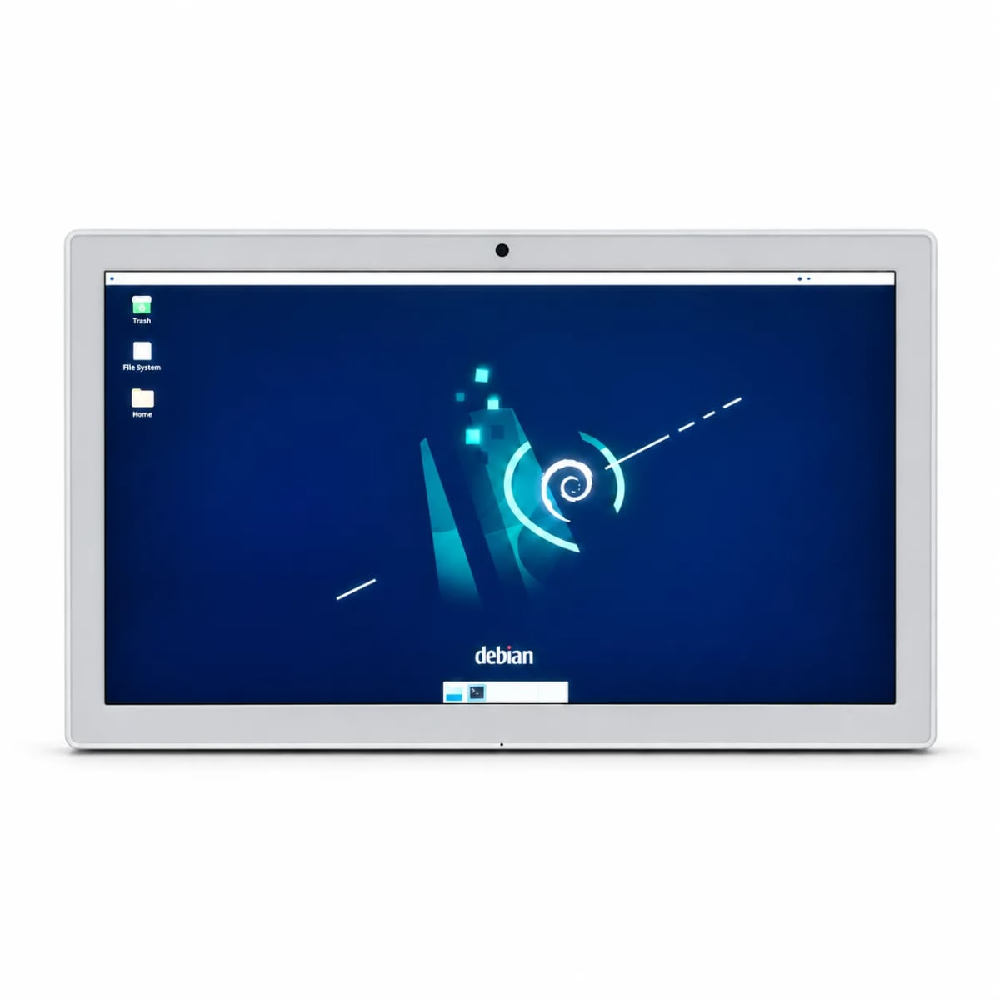
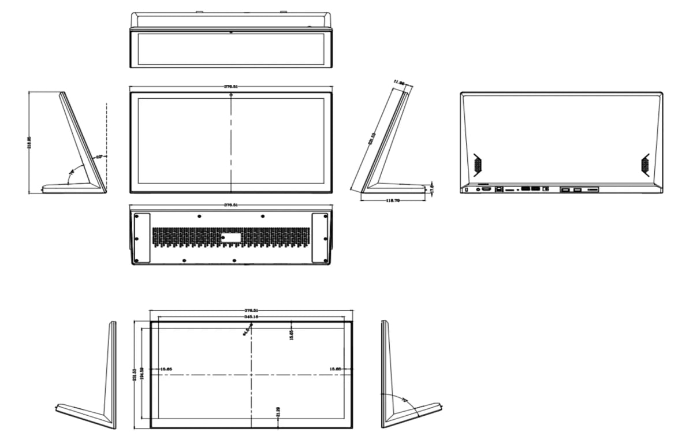
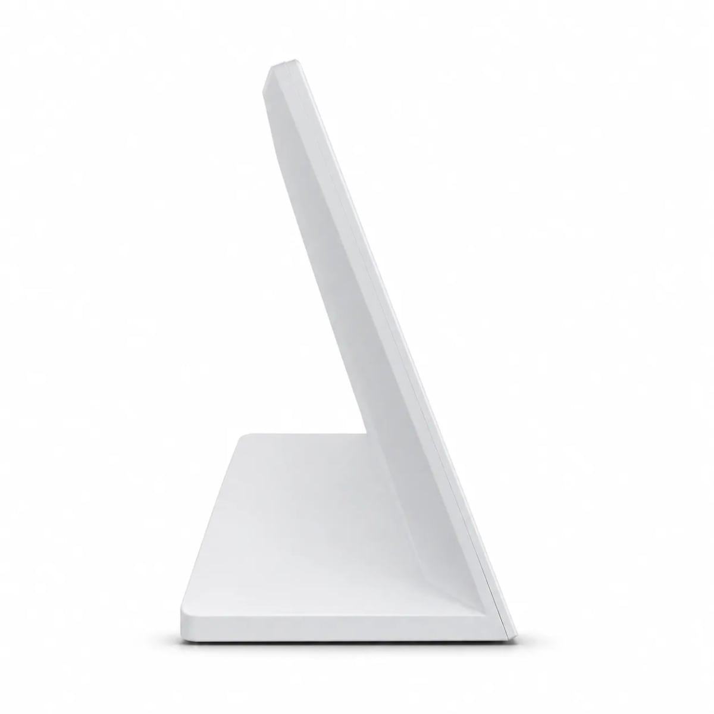
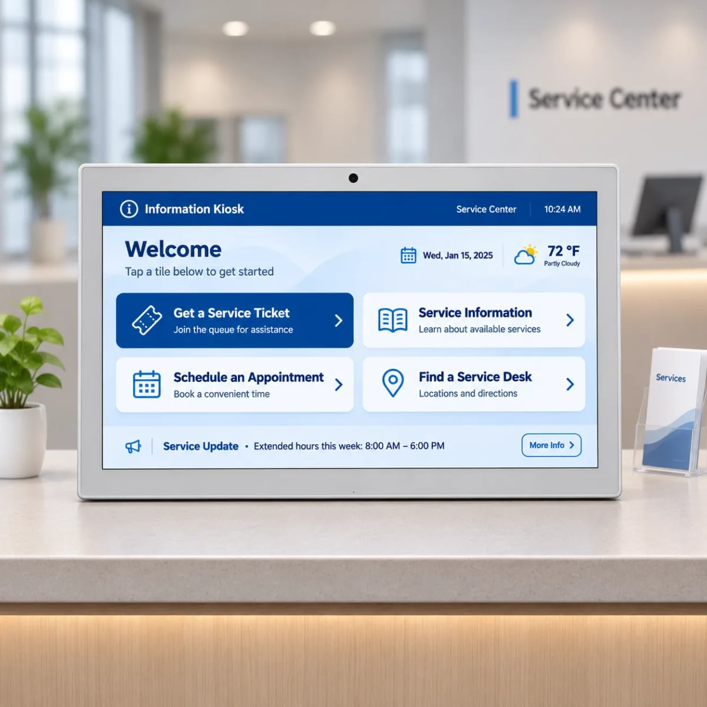
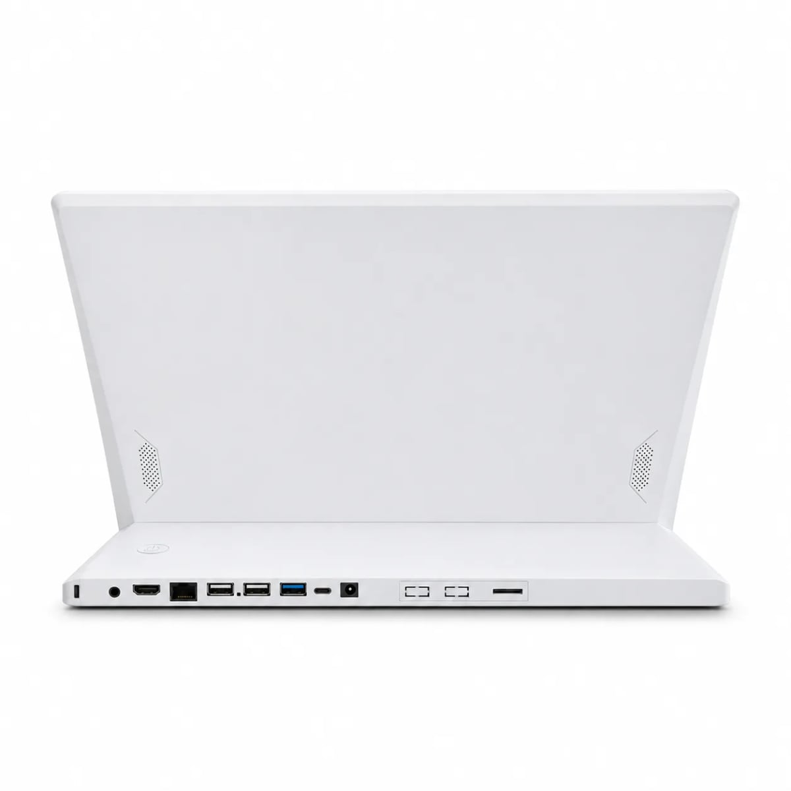

# HYY-L156T-3588 15.6英寸桌面式触控一体机（搭载Rockchip RK3588）

> 型号: **HYY-L156T-3588** · 品牌: EELLNET · [在官网查看](https://www.demo-furniture.test/zh/products/interactive-kiosk/hyy-l156t-3588-countertop-touch-kiosk?utm_source=github&utm_medium=referral&utm_campaign=products)

HYY-L156T-3588是一款15.6英寸桌面式触控一体机，采用Rockchip RK3588八核处理器，配备8G内存、128G存储，运行Linux。其1920×1080面板、电容触控和完整接口排布，使其适用于零售和服务柜台场景；该平台可按项目订单提供OEM/ODM定制。

## 产品亮点

- **RK3588八核平台** — Rockchip RK3588采用64位big.LITTLE架构（4× Cortex-A76 + 4× Cortex-A55），搭配8G内存和128G存储，运行Linux。
- **15.6英寸1920×1080触控面板** — 16:9面板，1920×1080分辨率，电容触控，亮度300 nits，对比度1000:1，视角85/85/85/85。
- **外设与有线网络接口** — HDMI×1、USB2.0×1、USB3.0×1、RJ45×1、3.5mm音频×1、TF×1和DC输入，采用12V/2A供电。
- **桌面放置与VESA孔位** — 可作为桌面设备放在柜台上，背部带有75×75 mm VESA孔位，便于固定件设计。
- **OEM/ODM定制** — 可配置主板、芯片、存储、内存、触控和扬声器；可定制外壳颜色和尺寸、操作系统、开机logo、包装和logo印刷。起订量为1台。
- **每台出货前均经过测试** — 每台设备出厂前均使用专用测试应用检查，并经过4小时以上压力测试。

## 规格参数

| 参数 | 数值 |
|---|---|
| 屏幕尺寸 | 15.6 inch |
| 分辨率 | 1920×1080 |
| 屏幕比例 | 16:9 |
| 亮度 | 300 nits |
| 对比度 | 1000:1 |
| 可视角度 | 85/85/85/85(L/R/U/D) ° |
| 触摸类型 | 电容触摸 |
| 操作系统 | Linux |
| 处理器 | Rockchip RK3588, octa-core 64-bit big.LITTLE architecture: 4x Cortex-A76 + 4x Cortex-A55 |
| 内存 | 8G |
| 存储 | 128G |
| 喇叭 | 2×2W |
| 接口 | HDMI×1, USB2.0×1, USB3.0×1, RJ45×1, 3.5mm耳机×1, TF×1, DC电源口×1 |
| 电源 | 12V/2A |
| VESA 孔距 | 75×75 mm |
| 安装方式 | 桌面 |
| 工作温度 | 0~50 ℃ |

## 应用场景

- **零售柜台** — 将设备放在收银台或服务柜台上，通过15.6英寸屏幕展示促销、产品详情和门店信息。电容触控让员工或顾客直接翻页，2×2W扬声器可播放带声音的短视频。
- **快餐（QSR）柜台** — 在点餐柜台，显示屏通过1920×1080面板展示套餐、每日优惠和柜台信息，近距离观看依然清晰。RK3588平台和128G存储为轮播内容留出空间，纤薄底座上的倾斜屏幕让显示面始终朝向顾客。
- **银行网点与服务台** — 网点和 service desk 团队可用该设备显示排队信息、政策公告和访客可在触摸屏上填写的简短反馈表。有线RJ45接口适用于具备固定网络连接的柜台，0~50 ℃工作范围适合常规室内网点环境。

## 产品详情

### 外设、存储与有线网络接口

后部底座设有完整接口：HDMI×1、USB2.0×1、USB3.0×1、RJ45×1、3.5mm音频孔、TF卡槽和DC电源输入。设备采用12V/2A供电，两个扬声器格栅位于接口排布旁，因此音频与线缆从同一面输出。

### 用于柜台规划的尺寸图

图纸包含正视图、侧视图、俯视图和接口布局图，便于集成商在下单前规划柜台空间和走线。面板为15.6英寸，16:9比例，1920×1080分辨率，背部支持75×75 mm VESA孔位。

### 纤薄桌面底座上的倾斜屏幕

该设备为桌面安装设计，屏幕以一定角度安装在纤薄底座上，便于站在柜台前的人阅读。15.6英寸面板亮度为300 nits，对比度1000:1，左右上下视角均为85/85/85/85，工作温度为0至50 ℃。

### 在服务中心柜台使用

放在服务中心柜台时，显示屏可显示欢迎页面，访客可通过触控逐步浏览信息。电容面板、1920×1080分辨率和2×2W扬声器适合播放短欢迎视频和自助页面，RK3588平台配8G内存和128G存储可将内容保存在设备本地。

## 常见问题

**HYY-L156T-3588的主要规格有哪些？**

这是一款15.6英寸桌面式显示器，分辨率为1920×1080，宽高比16:9，亮度300 nits，对比度1000:1，视角85/85/85/85。采用电容触控，基于Rockchip RK3588八核处理器（4× Cortex-A76 + 4× Cortex-A55）运行Linux，配备8G内存和128G存储，内置2×2W扬声器，供电为12V/2A。

**批量下单前可以先订购样品吗？**

可以。起订量为1台，您可以先下单样品，验证质量和适配情况后再决定批量生产。交期方面，旺季约一个月，淡季15个工作日内。

**OEM/ODM可以定制哪些内容？**

硬件可选配主板、芯片、存储、内存、触控和扬声器。外观可定制外壳颜色和尺寸，软件可定制操作系统和开机logo，包装及客户logo印刷也可提供。

**该产品的质保和售后支持是怎样的？**

每台整机均提供1年质保。支持方式包括邮件 info@eellnet.com、电话或WhatsApp +86 177 5783 8687

**你们接受哪些贸易条款和付款方式？**

我们支持EXW、FOB、CIF、CFR、DDP和DAP，接受L/C、T/T、D/P和PayPal。最近港口为深圳。

**该型号具备哪些认证？**

认证要求取决于目标市场和产品版本，因此我们不会对全系列统一使用同一证书。我们可作为服务为您的目标市场提供产品认证申请支持。

## 图片

---

[English](README.md) · 产品资料来自官网: [www.demo-furniture.test/zh/products/interactive-kiosk/hyy-l156t-3588-countertop-touch-kiosk](https://www.demo-furniture.test/zh/products/interactive-kiosk/hyy-l156t-3588-countertop-touch-kiosk?utm_source=github&utm_medium=referral&utm_campaign=products)
