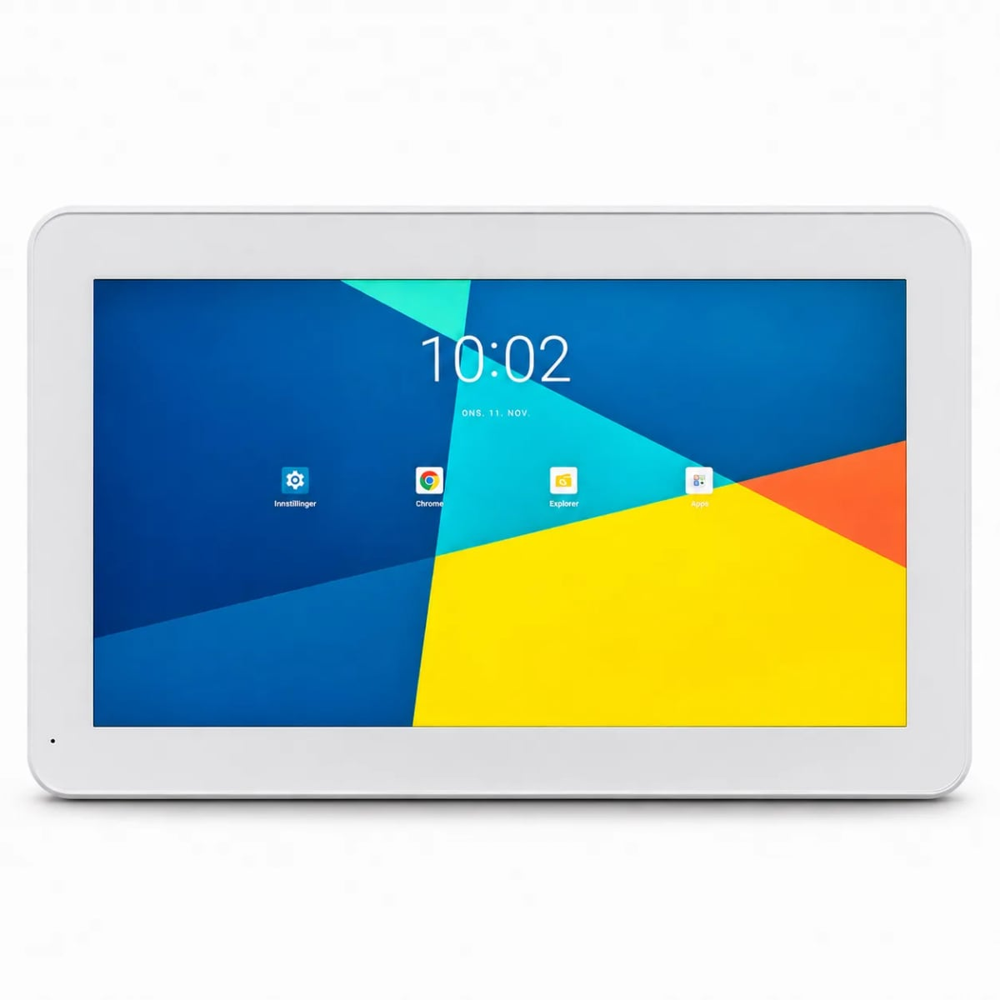
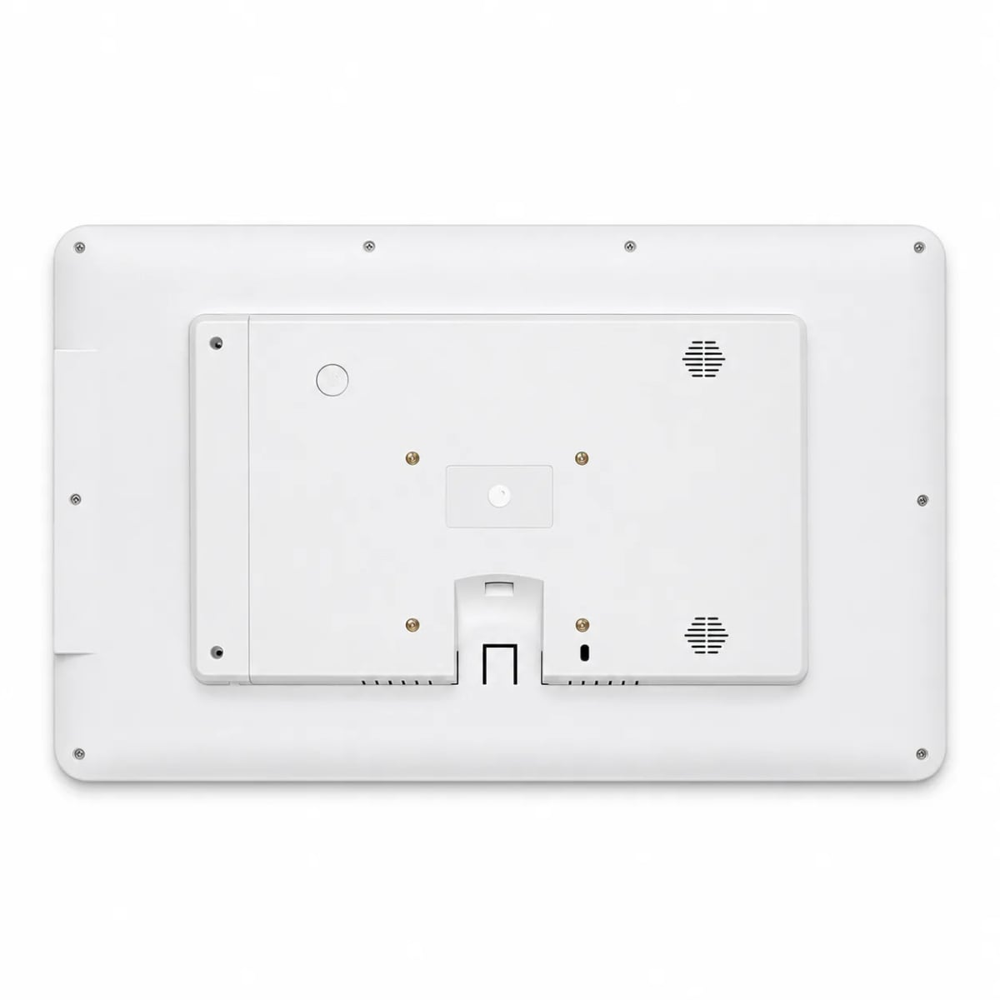
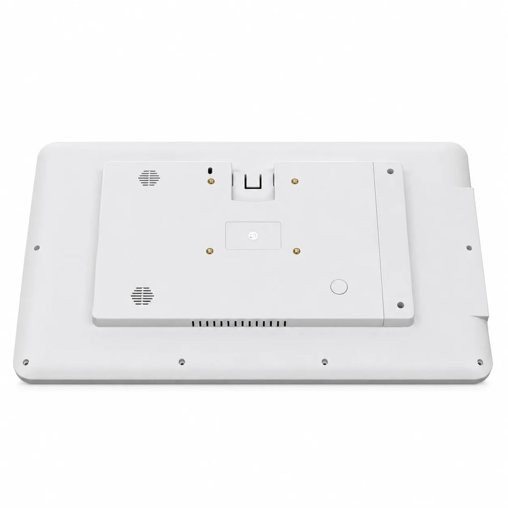
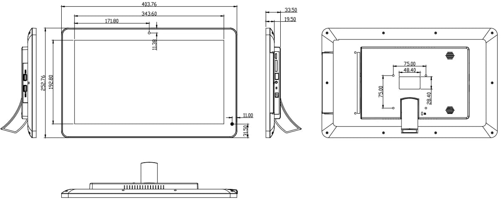
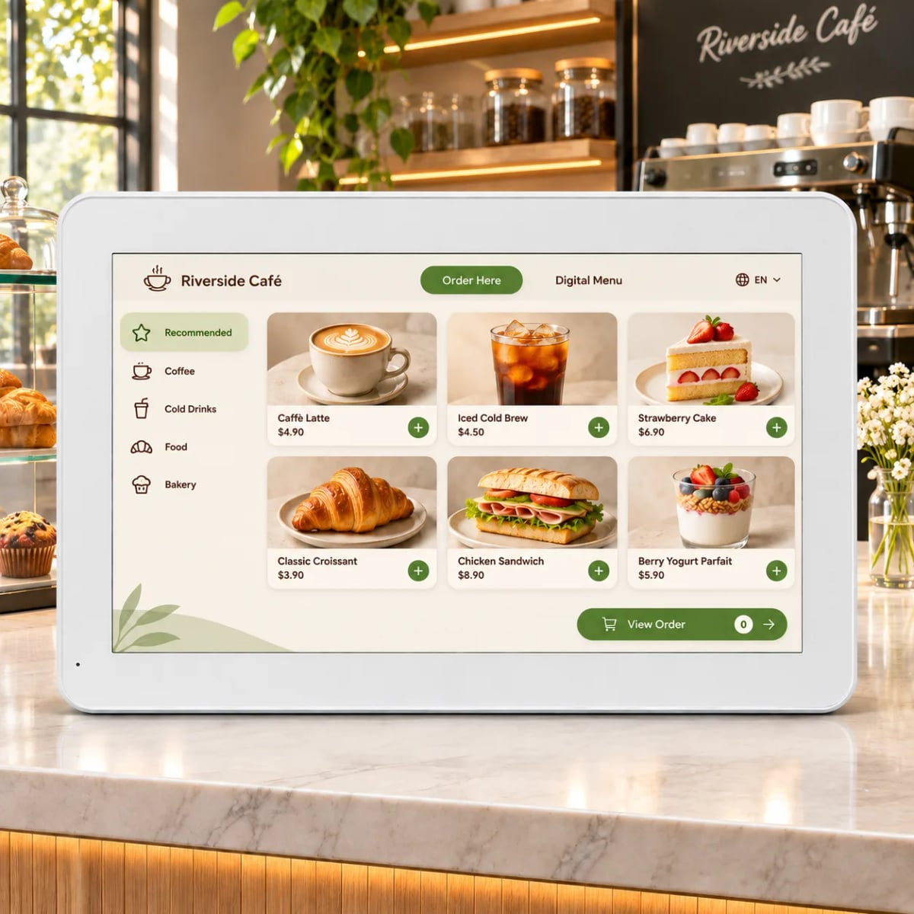

# 15.6 Inch Wall Mounted LCD Advertising Player with Capacitive Touch and Android

> Model: **HYY-TA1566** · Brand: EELLNET · [View on the official website](https://www.eellnet.com/products/indoor-lcd/15-6-inch-wall-mounted-lcd-advertising-player?utm_source=github&utm_medium=referral&utm_campaign=products)

The EELLNET HYY-TA1566 is a 15.6 inch wall mounted LCD advertising player designed for indoor retail, QSR and corporate spaces. A 1920 × 1080 IPS panel, capacitive touch and an Android platform sit in a 33.5 mm deep housing that fixes to the wall with a 75 × 75 mm VESA pattern. Memory, storage, interfaces, housing and branding can be specified through OEM / ODM customization.

## Highlights

- **Wall mounted, compact footprint** — The housing measures 403.76 × 252.76 × 33.5 mm and weighs 1.4 kg, so it takes little space on a wall or panel. Mounting uses the 75 × 75 mm VESA pattern for a direct wall installation.
- **Capacitive touch surface** — A capacitive touch layer sits over the 15.6 inch panel, letting viewers tap through product information, promotions or self-service content. The touch function is driven by the onboard Android platform.
- **1920 × 1080 IPS display** — The 16:9 IPS panel runs at 1920 × 1080 with 250 nits brightness, a 700 contrast ratio and 89/89/89/89 (L/R/U/D) degree viewing angles, keeping text and pricing legible from off-axis positions.
- **Android hardware platform** — A 64-bit quad-core Cortex-A55 processor at 1.8 GHz runs the Android operating system, paired with 2GB/4GB memory and 16GB/32GB storage. Content playback software is chosen by the integrator or brand owner.
- **Wired and wireless connectivity** — WiFi, Bluetooth and Ethernet (RJ45) are provided, plus HDMI out ×1, USB 3.0 ×1, USB 2.0 ×1, TF ×1, a 3.5 mm earphone jack and 2 × 3 W speakers for local audio.
- **OEM / ODM to your specification** — Choose board, chip, memory, storage, touch and speakers, customize housing color and size, operating system and boot logo, packaging and printed logo. Minimum order quantity is 1 unit, so a sample order can be placed before volume.

## Specifications

| Parameter | Value |
|---|---|
| Screen Size | 15.6 inch |
| Resolution | 1920*1080 |
| Aspect Ratio | 16:9 |
| Panel Type | IPS |
| Brightness | 250 nits |
| Contrast Ratio | 700 |
| Viewing Angle | 89/89/89/89(L/R/U/D) ° |
| Touch Type | Capacitive Touch |
| Operating System | Android |
| CPU | 64bit Quad core cortex A55,1.8G,RK3566 |
| Memory (RAM) | 2GB/4GB |
| Storage | 16GB/32GB |
| Network | WiFi / Bluetooth / Ethernet |
| Speakers | 2*3W |
| Interfaces | HDMI out×1, USB 3.0×1, USB 2.0×1, RJ45×1, 3.5mm earphone, DC power input, TF×1 |
| Power Supply | Adapter,12V,2.5A |
| Dimensions | 403.76×252.76×33.5 mm |
| Net Weight | 1.4 kg |
| VESA Mount | 75×75 mm |
| Installation | Wall Mounted |
| Operating Temperature | 0~40 ℃ |
| Certifications | CE |

## Use Cases

- **Retail** — Mount the player on walls, pillars or shelving runs to show product details, current pricing and promotions next to the goods. The capacitive touch layer lets shoppers pull up specifications themselves, while WiFi or Ethernet keeps multiple units updated from one place.
- **QSR & Order Boards** — Use the 15.6 inch screen as a wall mounted order or pricing board above service points, where 250 nits brightness and 89/89/89/89 degree viewing angles keep the layout readable from different positions in the queue. Ethernet or WiFi lets head office push updated offers to each site's player.
- **Corporate & Education** — Place the player in reception areas, corridors, classrooms and training rooms for wayfinding, notices and schedules. The slim 33.5 mm housing and 75 × 75 mm VESA fit narrow wall sections, and touch access lets staff or students browse the information on screen.

## Product Details

### A slim wall mounted housing for indoor walls

The HYY-TA1566 measures 403.76 × 252.76 × 33.5 mm and weighs 1.4 kg, so it sits close to the wall instead of projecting into walkways. Installation is wall mounted using the 75 × 75 mm VESA pattern, which suits retail pillars, reception walls and classroom partitions. Recommended operating temperature is 0~40 ℃, and the unit is powered by a 12V, 2.5A adapter. All digital signage units are packed to international shipping standards with shock-absorbing materials and reinforced boxes, and delivery is organized through reliable logistics partners.

### Display and capacitive touch

The 15.6 inch IPS panel runs at 1920 × 1080 resolution with a 16:9 aspect ratio, 250 nits brightness and a 700 contrast ratio, so text, prices and notices stay clear. Viewing angles of 89/89/89/89 (L/R/U/D) degrees mean the screen remains readable when viewers stand to the side of the wall. A capacitive touch layer covers the panel, so content can be browsed on screen; the touch function is handled by the onboard Android platform.

### Android hardware and the interface set

A 64-bit quad-core Cortex-A55 processor running at 1.8 GHz powers the Android operating system, with 2GB/4GB memory and 16GB/32GB storage configurations. Networking covers WiFi, Bluetooth and Ethernet, so units can be connected wirelessly or by cable. The interface set includes HDMI out ×1, USB 3.0 ×1, USB 2.0 ×1, RJ45 ×1, a 3.5 mm earphone jack, a TF slot and a DC power input, plus 2 × 3 W built-in speakers for local audio.

### OEM / ODM, quality control and export support

EELLNET has been exporting since July 2014 and now ships to 38 countries across North America, South America, Eastern and Western Europe, Southeast Asia, East Asia, the Middle East, Africa and Oceania. Production runs on 2 lines with an average of about 7000 units per month, and every device is tested with a dedicated test app plus more than 4 hours of stress-test aging before shipment. OEM / ODM work covers hardware selection, housing color and size, operating system and boot logo, packaging and printed logo, with a minimum order quantity of 1 unit so a sample order can come first. Visitors are welcome to schedule a factory tour, and product certification support is available on request. Trade terms include EXW, FOB, CIF, CFR, DDP and DAP from Shenzhen, with payment by L/C, T/T, D/P or PayPal.

## FAQ

**Can I order one unit before committing to volume?**

Yes. The minimum order quantity is 1 unit, and a sample order can be placed first so you can verify quality before the bulk order.

**What can be customized under OEM / ODM?**

Hardware options include board, chip, memory, storage, touch and speakers. The housing color and size can be customized, the operating system and boot logo can be changed, and packaging and printed logo can be tailored to your brand.

**How is each player tested before shipment?**

Every unit is tested with a dedicated test app before it leaves the line, followed by a stress-test aging run of more than 4 hours.

**Which trade terms and port do you work with?**

EXW, FOB, CIF, CFR, DDP and DAP are available, with Shenzhen as the nearest port.

**Does the player support wired networking?**

Yes. The interface set includes an RJ45 Ethernet port, alongside WiFi and Bluetooth, plus HDMI out ×1, USB 3.0 ×1, USB 2.0 ×1, TF ×1 and a 3.5 mm earphone jack.

**Is this model certified?**

The HYY-TA1566 is listed with CE certification. Let us know which documents your project requires and we can discuss product certification support.

## Gallery

  

---

[中文](README.zh-CN.md) · Product information from the official website: [www.eellnet.com/products/indoor-lcd/15-6-inch-wall-mounted-lcd-advertising-player](https://www.eellnet.com/products/indoor-lcd/15-6-inch-wall-mounted-lcd-advertising-player?utm_source=github&utm_medium=referral&utm_campaign=products)
