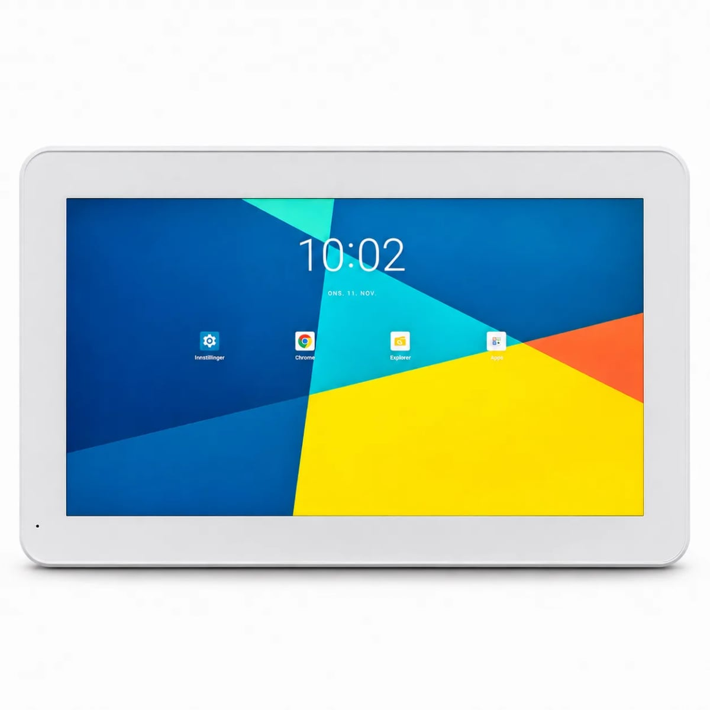
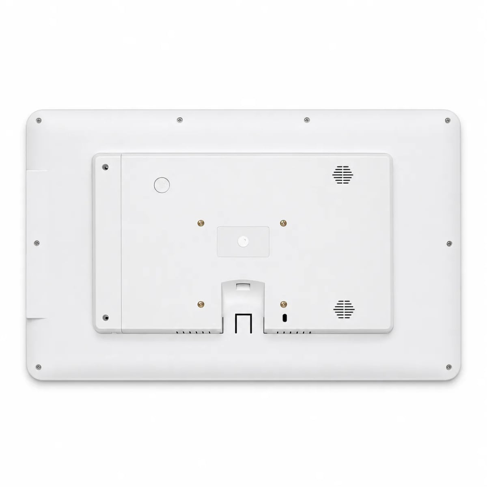
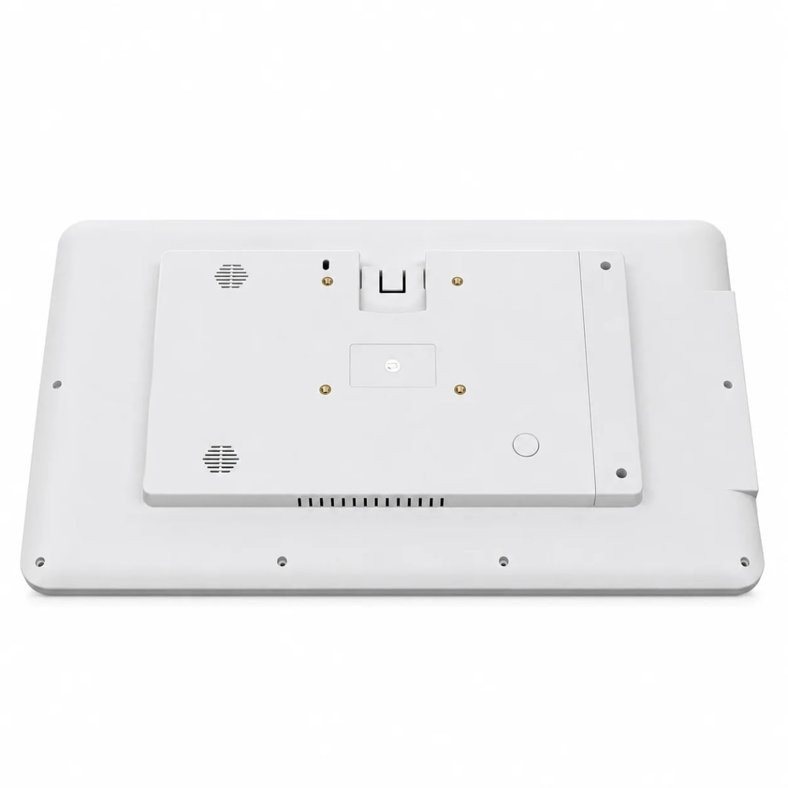
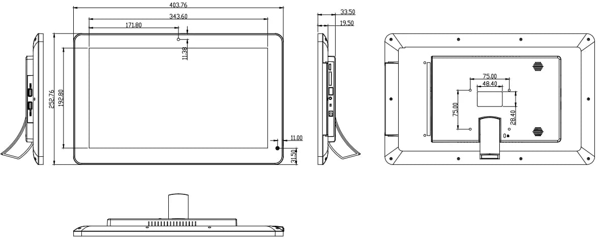

# 15.6 英寸壁挂式 LCD 广告机，带电容触摸和 Android 系统

> 型号: **HYY-TA1566** · 品牌: EELLNET · [在官网查看](https://www.eellnet.com/zh/products/indoor-lcd/15-6-inch-wall-mounted-lcd-advertising-player?utm_source=github&utm_medium=referral&utm_campaign=products)

EELLNET HYY-TA1566 是一款 15.6 英寸壁挂式 LCD 广告机，专为室内零售、餐饮连锁及企业空间设计。1920 × 1080 IPS 面板、电容触摸和 Android 平台集成在 33.5 mm 厚的机壳内，可通过 75 × 75 mm VESA 孔位固定于墙面。内存、存储、接口、机壳和品牌标识均可通过 OEM / ODM 定制。

## 产品亮点

- **壁挂安装，占用空间小** — 机壳尺寸为 403.76 × 252.76 × 33.5 mm，重 1.4 kg，在墙面或面板上占用空间很小。采用 75 × 75 mm VESA 孔位，可直接壁挂安装。
- **电容触摸表面** — 15.6 英寸面板表面覆盖电容触摸层，观看者可点按浏览产品信息、促销内容或自助服务内容。触摸功能由板载 Android 平台驱动。
- **1920 × 1080 IPS 显示屏** — 16:9 IPS 面板分辨率为 1920 × 1080，亮度 250 nits，对比度 700，可视角度 89/89/89/89（左/右/上/下）度，在偏轴位置也能清晰读取文字和价格。
- **Android 硬件平台** — 64 位四核 Cortex-A55 处理器主频 1.8 GHz，运行 Android 操作系统，搭配 2GB/4GB 内存和 16GB/32GB 存储。内容播放软件由集成商或品牌方自行选择。
- **有线与无线连接** — 提供 WiFi、蓝牙和以太网（RJ45），另有 HDMI 输出 ×1、USB 3.0 ×1、USB 2.0 ×1、TF ×1、3.5 mm 耳机孔和 2 × 3 W 扬声器用于本地音频播放。
- **按需 OEM / ODM 定制** — 可选主板、芯片、内存、存储、触摸和扬声器，可定制机壳颜色与尺寸、操作系统与开机LOGO、包装和印刷LOGO。最小起订量为 1 台，可在批量前先下样品单。

## 规格参数

| 参数 | 数值 |
|---|---|
| 屏幕尺寸 | 15.6 inch |
| 分辨率 | 1920*1080 |
| 屏幕比例 | 16:9 |
| 面板类型 | IPS |
| 亮度 | 250 nits |
| 对比度 | 700 |
| 可视角度 | 89/89/89/89(L/R/U/D) ° |
| 触摸类型 | 电容触摸 |
| 操作系统 | 安卓 |
| 处理器 | 64bit Quad core cortex A55,1.8G,RK3566 |
| 内存 | 2GB/4GB |
| 存储 | 16GB/32GB |
| 网络 | WiFi / 蓝牙 / 有线网口 |
| 喇叭 | 2*3W |
| 接口 | HDMI out×1, USB 3.0×1, USB 2.0×1, RJ45×1, 3.5mm earphone, DC power input, TF×1 |
| 电源 | Adapter,12V,2.5A |
| 整机尺寸 | 403.76×252.76×33.5 mm |
| 净重 | 1.4 kg |
| VESA 孔距 | 75×75 mm |
| 安装方式 | 壁挂 |
| 工作温度 | 0~40 ℃ |
| 认证 | CE |

## 应用场景

- **零售** — 将设备安装在墙面、立柱或货架通道上，在商品旁展示产品详情、最新价格和促销信息。电容触摸层让顾客可自行查看规格，WiFi 或以太网则可在同一地点更新多台设备。
- **餐饮与点单看板** — 将 15.6 英寸屏幕作为壁挂式点单或价目看板安装在服务点上方，250 nits 亮度和 89/89/89/89 度可视角度让版面在排队队伍的不同位置都清晰可读。通过以太网或 WiFi，总部可向各门店设备推送最新优惠。
- **企业与教育** — 将设备放置在接待区、走廊、教室和培训室，用于导视、通知和日程显示。33.5 mm 纤薄机壳和 75 × 75 mm VESA 适合狭窄墙面，触摸功能让员工或学生可直接在屏幕上浏览信息。

## 产品详情

### 纤薄壁挂机壳，适合室内墙面

HYY-TA1566 尺寸为 403.76 × 252.76 × 33.5 mm，重 1.4 kg，紧贴墙面安装，不会凸出到通道中。采用 75 × 75 mm VESA 孔位壁挂安装，适用于零售立柱、接待区墙面和教室隔断。推荐工作温度为 0~40 ℃，设备通过 12V、2.5A 适配器供电。所有数字标牌设备均按国际运输标准包装，采用减震材料和加固纸箱，并通过可靠的物流合作伙伴安排发货。

### 显示与电容触摸

15.6 英寸 IPS 面板分辨率为 1920 × 1080，16:9 比例，亮度 250 nits，对比度 700，文字、价格和通知清晰易读。89/89/89/89（左/右/上/下）度可视角度，即使观看者站在墙面侧方，屏幕内容依然清晰可读。面板表面覆盖电容触摸层，可直接在屏幕上浏览内容；触摸功能由板载 Android 平台处理。

### Android 硬件与接口配置

64 位四核 Cortex-A55 处理器主频 1.8 GHz，驱动 Android 操作系统，提供 2GB/4GB 内存和 16GB/32GB 存储配置。网络支持 WiFi、蓝牙和以太网，可无线或有线连接。接口配置包括 HDMI 输出 ×1、USB 3.0 ×1、USB 2.0 ×1、RJ45 ×1、3.5 mm 耳机孔、TF 卡槽和 DC 电源输入，另有 2 × 3 W 内置扬声器用于本地音频播放。

### OEM / ODM、品控与出口支持

EELLNET 自 2014 年 7 月起开展出口业务，目前发货至北美、南美、东西欧、东南亚、东亚、中东、非洲和大洋洲的 38 个国家。生产由 2 条产线运行，月均产能约 7000 台，每台设备出货前均使用专用测试程序检测，并进行 4 小时以上的压力老化测试。OEM / ODM 涵盖硬件选型、机壳颜色与尺寸、操作系统与开机LOGO、包装和印刷LOGO，最小起订量为 1 台，可先下样品单。欢迎预约到厂参观，并可应要求提供产品认证支持。贸易条款包括 EXW、FOB、CIF、CFR、DDP 和 DAP，发货港为深圳，付款方式支持 L/C、T/T、D/P 或 PayPal。

## 常见问题

**可以先订1台，再决定是否批量采购吗？**

可以。最小起订量为1台，可先下样品单，确认品质后再进行批量采购。

**OEM / ODM 可以定制哪些内容？**

硬件可选主板、芯片、内存、存储、触摸和扬声器；机壳颜色与尺寸可定制，操作系统和开机LOGO可更改，包装与印刷LOGO也可按您的品牌定制。

**每台设备在出货前如何测试？**

每台设备出厂前都会使用专用测试程序进行检测，随后再进行4小时以上的压力老化测试。

**你们支持哪些贸易条款？使用哪个港口？**

可选 EXW、FOB、CIF、CFR、DDP 和 DAP，最近港口为深圳。

**该设备支持有线网络吗？**

支持。接口配置包含 RJ45 网口，同时具备 WiFi 和蓝牙，另有 HDMI 输出 ×1、USB 3.0 ×1、USB 2.0 ×1、TF ×1 和 3.5 mm 耳机孔。

**这个型号有认证吗？**

HYY-TA1566 已通过 CE 认证。请告知您的项目需要哪些文件，我们可以进一步沟通产品认证支持。

## 图片

  

---

[English](README.md) · 产品资料来自官网: [www.eellnet.com/zh/products/indoor-lcd/15-6-inch-wall-mounted-lcd-advertising-player](https://www.eellnet.com/zh/products/indoor-lcd/15-6-inch-wall-mounted-lcd-advertising-player?utm_source=github&utm_medium=referral&utm_campaign=products)
