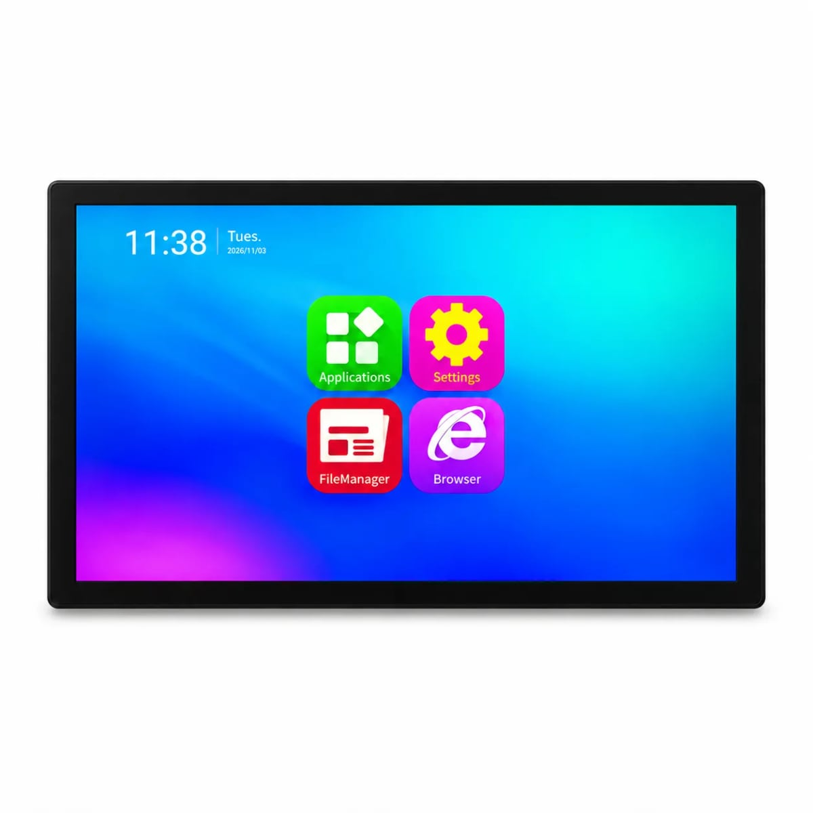
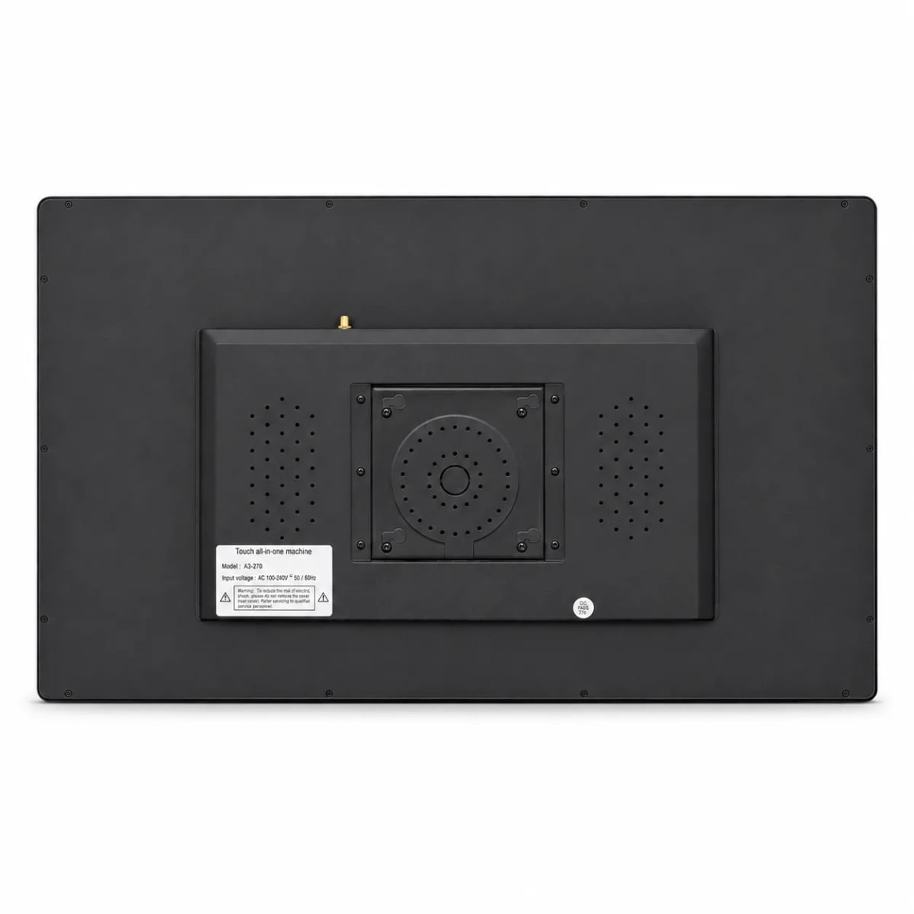

# HYY-TS-A3270-69 27 Inch Wall Mounted Interactive Kiosk with 2560*1440 IPS Touch Display

> Model: **HYY-TS-A3270-69** · Brand: EELLNET · [View on the official website](https://www.eellnet.com/products/interactive-kiosk/hyy-ts-a3270-69-wall-mounted-interactive-kiosk?utm_source=github&utm_medium=referral&utm_campaign=products)

The HYY-TS-A3270-69 is a 27 inch wall mounted interactive kiosk built around a 2560*1440 IPS panel with a 16:9 aspect ratio and capacitive touch. It runs on an Android platform with an RK3576 quad-core Cortex-A53 + Quad-core Cortex-A72 CPU, 4GB RAM and 32GB storage, and its bottom connection panel carries HDMI output, USB 3.0, USB 2.0, USB2.0 OTG, RJ45 Ethernet, a 3.5mm earphone jack and DC12V input. EELLNET builds this model for retail and hospitality projects, with OEM / ODM customization available from a single sample unit.

## Highlights

- **27 Inch 2560*1440 IPS Panel** — A 16:9 IPS screen at 300 nits brightness with a 1000:1 contrast ratio and a 178°(H/V) viewing angle, so graphics and text stay readable when viewers stand to either side of the unit.
- **Capacitive Touch Control** — Visitors and staff operate the page directly on the 27 inch screen through capacitive touch, with no separate keyboard or mouse needed at the wall.
- **Android Platform with RK3576 CPU** — Quad-core Cortex-A53 + Quad-core Cortex-A72 processing, 4GB RAM and 32GB storage support app-driven pages and locally stored content.
- **Wall Mounted Installation** — The rear mounting plate fixes the unit flat against the wall, keeping floor area free in stores, receptions and corridors. Operating temperature is 0~40 ℃.
- **Connection Panel for Peripherals** — HDMI output, USB 3.0, USB 2.0, USB2.0 OTG, RJ45 Ethernet, a 3.5mm earphone jack and DC12V input sit along the bottom edge for tidy cable routing.
- **OEM / ODM Customization** — Mainboard, chip, storage, memory, touch and speaker options can be selected, and housing colour, size, startup screen, packaging and logo printing can be customized. Minimum order quantity is 1 unit, so a sample can be checked before a volume order.

## Specifications

| Parameter | Value |
|---|---|
| Screen Size | 27 inch |
| Resolution | 2560*1440 |
| Aspect Ratio | 16:9 |
| Panel Type | IPS |
| Brightness | 300 nits |
| Contrast Ratio | 1000：1 |
| Viewing Angle | 178°(H/V) ° |
| Touch Type | Capacitive Touch |
| Operating System | Android |
| CPU | Quad-core Cortex-A53 + Quad-core Cortex-A72, RK3576 |
| Memory (RAM) | 4GB |
| Storage | 32GB |
| Speakers | 2*5W |
| Interfaces | HDMI output×1, USB 3.0×1, USB 2.0×1, USB2.0 OTG×1, RJ45 Ethernet×1, 3.5mm earphone×1, DC12V input |
| Power Supply | DC12V-5A input |
| Installation | Wall Mounted |
| Operating Temperature | 0~40 ℃ |

## Use Cases

- **Retail** — Mount the HYY-TS-A3270-69 on a wall in a store aisle or beside a product display to present item information, brand content and store announcements on a 27 inch 2560*1440 screen. Captive touch lets shoppers page through content themselves, while 32GB storage keeps the material on the device. RJ45 Ethernet supplies the wired network connection, and the 178°(H/V) viewing angle keeps the screen readable for shoppers approaching from the side.
- **Hospitality** — In hotels and other hospitality venues, the unit can be wall mounted in a reception or lobby area for guest information, directions and announcements. The Android platform runs the on-screen pages, and 2*5W speakers add audio to the visual content. Wall mounting keeps the floor clear in busy entrances, and the 300 nits, 1000:1 IPS panel holds detail in indoor lighting conditions.

## Product Details

### 27 Inch 2560*1440 IPS Screen in a Black Bezel

The front view shows the 27 inch display framed by a black bezel, sized for wall placement where space is limited. The panel runs at 2560*1440 resolution with a 16:9 aspect ratio, 300 nits brightness and a 1000:1 contrast ratio, and the 178°(H/V) viewing angle keeps the picture consistent for viewers standing off to the sides.

### Android Interface and App Access

The home screen presents applications as icons on the touch surface, with the interface running on an Android operating system. The RK3576 platform pairs a Quad-core Cortex-A53 with a Quad-core Cortex-A72, backed by 4GB RAM and 32GB storage for the pages and content stored on the device.

### Wall Mounted Interactive Kiosk with Rear Plate and Speakers

The rear view shows the central mounting plate that the unit hangs from, the speaker grilles and the product label. This is a wall mounted model, so it sits flat against the wall, and the 2*5W speakers provide audio for announcements and promotional content shown on screen.

### Dimension Drawing for Site Planning

The technical drawing covers front, side and mounting views of the 27 inch unit. Installers can use it to confirm wall space, fixing positions and the clearance behind the screen before the kiosk arrives on site, which shortens the fitting stage of a retail or hospitality project.

### Bottom Connection Panel and Interfaces

The angled rear view shows the connection ports grouped along the bottom edge. The interface set is HDMI output×1, USB 3.0×1, USB 2.0×1, USB2.0 OTG×1, RJ45 Ethernet×1, 3.5mm earphone×1 and DC12V input, with power supplied by a DC12V-5A input.

## FAQ

**What is the minimum order quantity for the HYY-TS-A3270-69?**

The minimum order quantity is 1 unit. A single sample can be ordered to verify quality before a larger production order, and OEM / ODM customization is available on the same basis.

**What is the lead time?**

Lead time is around one month during peak season and within 15 working days in the off-season. Shipment is arranged by reliable carriers from Shenzhen.

**What warranty comes with the unit?**

Every unit carries a 1 year warranty on the complete machine. Each device is also tested with a dedicated test APP and run through more than 4 hours of stress testing before it leaves the facility.

**Can the kiosk be customized for our brand?**

Yes. Hardware options include mainboard, chip, storage, memory, touch and speakers; the housing colour and size can be customized; software options cover the operating system and startup screen; packaging and customer logo printing can also be customized.

**What are the power and operating conditions?**

The unit runs from a DC12V-5A input and is rated for an operating temperature of 0~40 ℃. Power is supplied through the DC12V input on the bottom connection panel.

**Do you export to our region?**

EELLNET has exported since July 2014 and currently ships to 38 countries and regions, including Germany, the United States, the United Kingdom, Japan, Singapore, the UAE, Brazil and Mexico. Trade terms offered are EXW, FOB, CIF, CFR, DDP and DAP, with payment by L/C, T/T, D/P or PayPal.

## Gallery

 

## Contact

- **Email**: [info@eellnet.com](mailto:info@eellnet.com)
- **Phone**: +86 177 5783 8687
- **WhatsApp**: [+86 177 5783 8687](https://wa.me/8617757838687)
- **Address**: Room 704, Building 14, No. 62 Nanchang Road, Nanchang Community, Xixiang Subdistrict, Bao'an District, Shenzhen, Guangdong 518000, China

---

[中文](README.zh-CN.md) · Product information from the official website: [www.eellnet.com/products/interactive-kiosk/hyy-ts-a3270-69-wall-mounted-interactive-kiosk](https://www.eellnet.com/products/interactive-kiosk/hyy-ts-a3270-69-wall-mounted-interactive-kiosk?utm_source=github&utm_medium=referral&utm_campaign=products)
