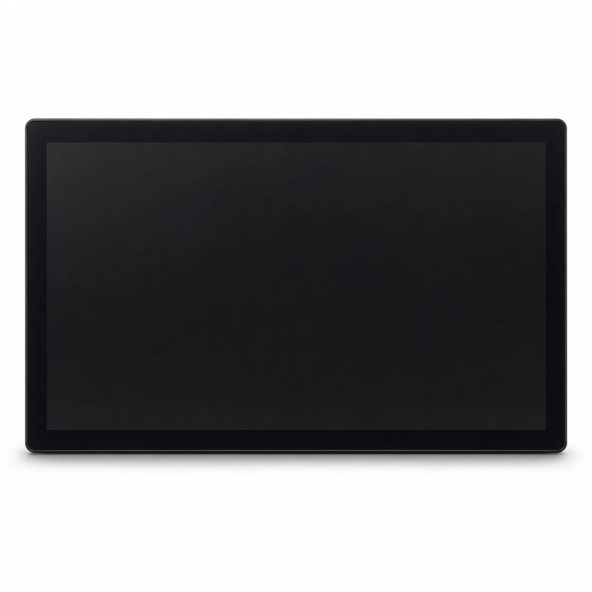
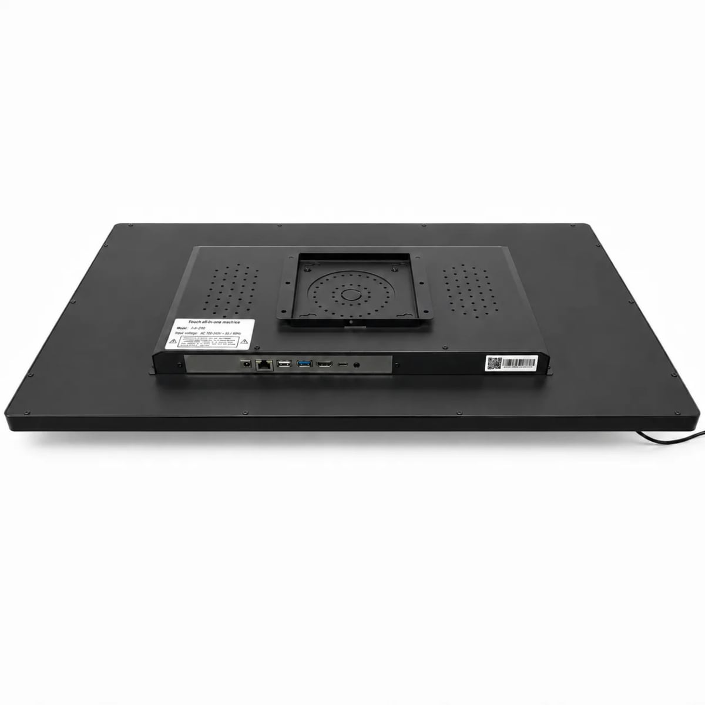
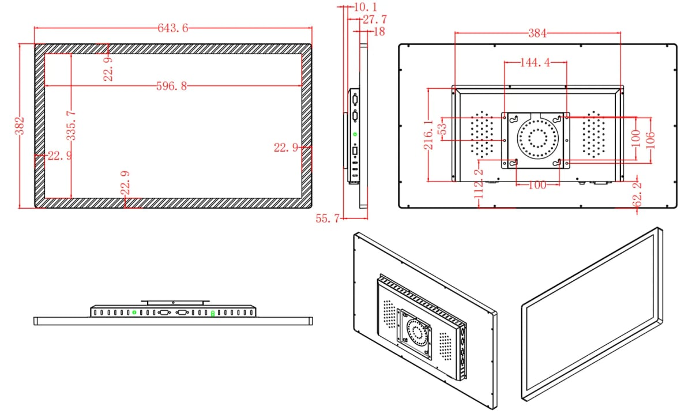
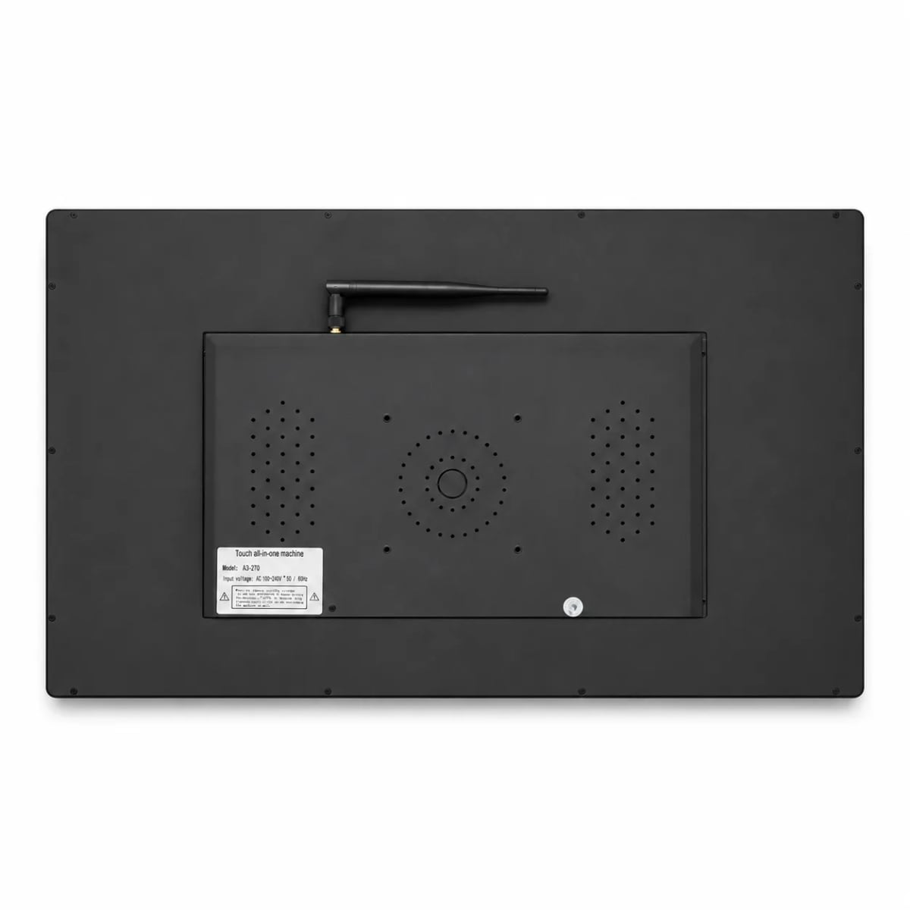
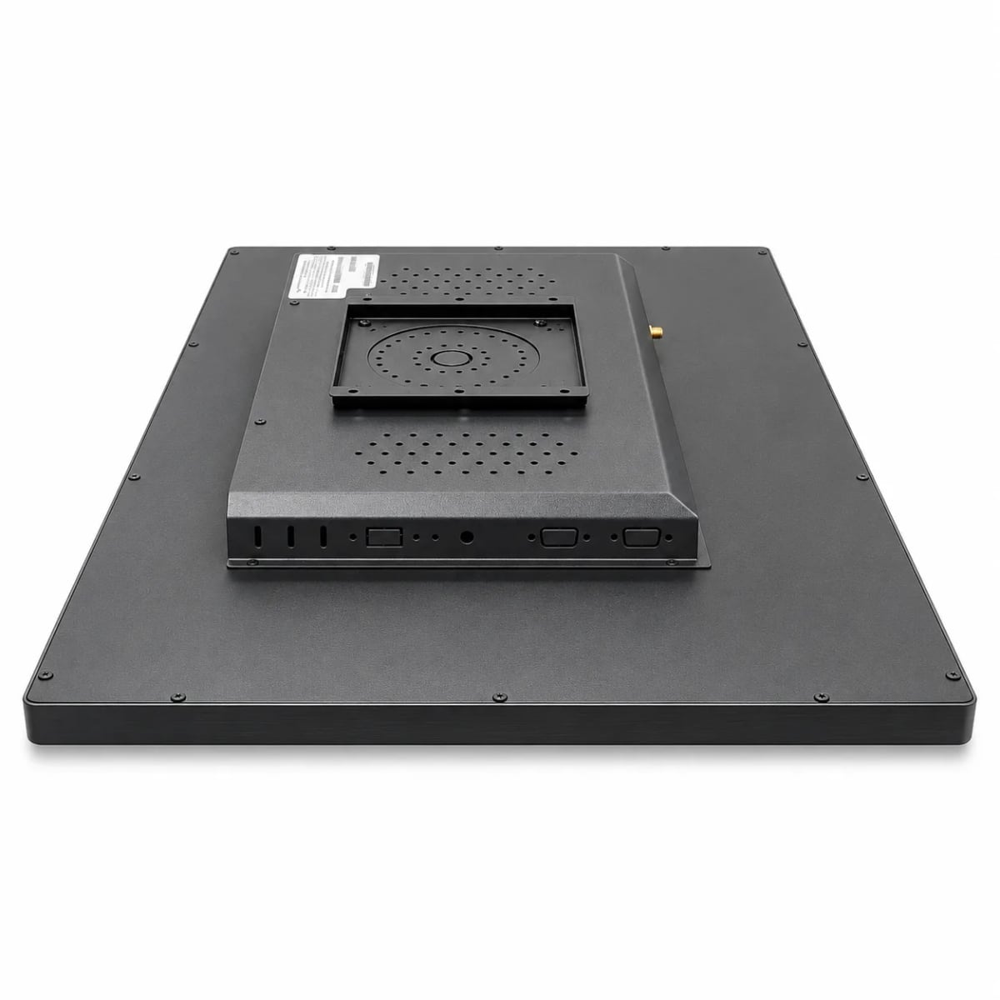
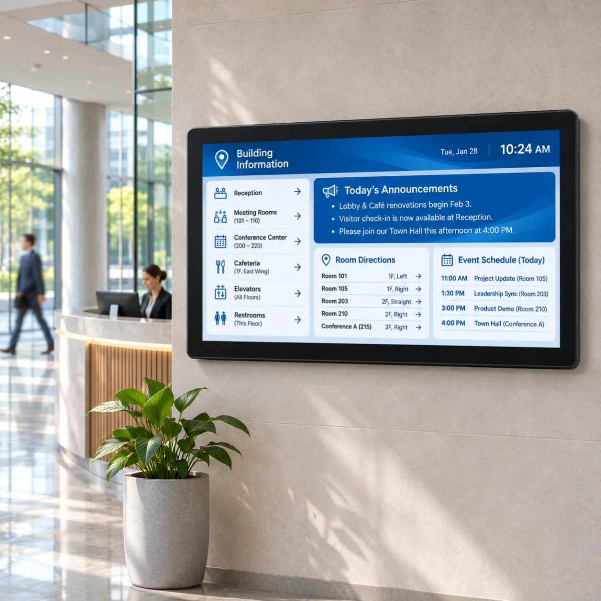

# HYY-TS-A3270-69 27-Inch Wall Mounted Digital Signage Kiosk with Capacitive Touch and 2560 x 1440 IPS Display

> Model: **HYY-TS-A3270-69** · Brand: EELLNET · [View on the official website](https://www.eellnetsignage.com/products/interactive-kiosk/hyy-ts-a3270-69-wall-mounted-digital-signage-kiosk?utm_source=github&utm_medium=referral&utm_campaign=products)

The HYY-TS-A3270-69 is a 27-inch wall mounted digital signage kiosk built around a 2560 x 1440 IPS panel with a capacitive touch surface and the Android operating system. Its RK3576 processor, 4GB RAM and 32GB storage run content on the device itself, while HDMI, USB and RJ45 ports connect players, storage and a wired network. EELLNET builds the unit in Shenzhen and supports OEM/ODM customization, with a 1-year warranty on the whole unit.

## Highlights

- **2560 x 1440 IPS panel** — The 27-inch 16:9 IPS panel runs at 2560 x 1440 with 300 nits brightness, a 1000:1 contrast ratio and 178/178 degree viewing angles, so the image holds up for viewers standing to the side.
- **Capacitive touch control** — A capacitive touch layer covers the panel, so content is operated directly on the 27-inch screen instead of through a separate controller.
- **Android on an RK3576 processor** — Quad-core Cortex-A53 plus quad-core Cortex-A72 processing with 4GB RAM and 32GB storage runs the Android operating system, giving integrators a base for their own content app.
- **Wall mounted, 55.7 mm deep** — The enclosure measures 643.6 x 382 x 55.7 mm and is designed for wall mounting, which keeps the space below the screen clear.
- **Ports for local players and wired networks** — HDMI x1, USB3.0 x1, USB2.0 x1, RJ45 x1, a 3.5 mm earphone jack and DC12V input cover local playback, a wired network link and audio output; two 5W speakers are built in.
- **OEM / ODM from 1 unit** — Customize the mainboard, chip, memory, storage, touch, speakers, housing colour and size, operating system and startup screen, packaging and your logo. A sample order can be placed before bulk production, and the minimum order quantity is 1 unit.

## Specifications

| Parameter | Value |
|---|---|
| Screen Size | 27 inch |
| Resolution | 2560*1440 |
| Aspect Ratio | 16:9 |
| Panel Type | IPS |
| Brightness | 300 nits |
| Contrast Ratio | 1000：1 |
| Viewing Angle | 178/178 ° |
| Touch Type | Capacitive Touch |
| Operating System | Android |
| CPU | Quad-core Cortex-A53 + Quad-core Cortex-A72, RK3576 |
| Memory (RAM) | 4GB |
| Storage | 32GB |
| Speakers | 2*5W |
| Interfaces | HDMI×1, USB3.0×1, USB2.0×1, RJ45×1, 3.5mm earphone, DC12V input |
| Power Supply | DC12V-5A input |
| Dimensions | 643.6x382x55.7 mm |
| Installation | Wall Mounted |
| Operating Temperature | 0~40 ℃ |

## Use Cases

- **Retail** — In shops, the unit is mounted on a wall near a product area to show ranges, promotions and store announcements on the 2560 x 1440 panel. Shoppers can use the capacitive touch layer to open the pages they need, so staff spend less time answering basic questions.
- **Quick Service Restaurants (QSR)** — In quick service restaurants the screen can be mounted at the order counter or on the wall behind it to show item listings and daily offers. The 300 nits panel and 178/178 degree viewing angles keep the listing readable across the counter, and staff can switch content with the capacitive touch layer or the supplied remote control.
- **Health Clinics** — Clinics and health centres use the screen in waiting areas for queue numbers, opening hours and announcements. Because the front is a capacitive touch surface and the content runs on Android, the same unit can present a simple check-in or wayfinding screen.
- **Building Lobbies and Reception Areas** — In building lobbies and reception areas the screen can be mounted beside the entrance to show a tenant directory, opening hours and announcements on a 2560 x 1440 panel. An RJ45 port provides a wired network connection for the device.

## Product Details

### Front view: slim bezel and a blank touch surface

The front of the HYY-TS-A3270-69 is a black 27-inch panel with a slim bezel, shown here with the screen at rest. Behind it is an IPS panel at 2560 x 1440 with a 16:9 aspect ratio, 300 nits brightness and a 1000:1 contrast ratio; the 178/178 degree viewing angles keep the image even for viewers who are not directly in front of the screen.

### Side ports: HDMI, USB, RJ45 and audio

The angled rear view shows the port cluster at the side of the housing: HDMI x1, USB3.0 x1, USB2.0 x1, RJ45 x1, a 3.5 mm earphone jack and the DC12V input. Grouping them together simplifies cabling once the unit is on the wall.

### Rear mounting plate between two 5W speakers

The rear view shows the mounting plate fixed between the speaker grilles; this plate is the wall mounting point of the unit. The two built-in 5W speakers give the kiosk audio output for announcements and video content without extra hardware.

### Dimensions: 643.6 x 382 x 55.7 mm

The dimension drawing sets out the front, side and rear layouts of the unit. The enclosure measures 643.6 x 382 x 55.7 mm, and the operating temperature range is 0~40 ℃.

## FAQ

**What are the display specifications of the HYY-TS-A3270-69?**

A 27-inch IPS panel with 2560 x 1440 resolution, 16:9 aspect ratio, 300 nits brightness, 1000:1 contrast ratio and 178/178 degree viewing angles.

**Which interfaces does the kiosk provide?**

HDMI x1, USB3.0 x1, USB2.0 x1, RJ45 x1 and a 3.5 mm earphone jack. Power input is DC12V-5A.

**Can I order a customized version, and what is the minimum order quantity?**

Yes. OEM/ODM customization covers the mainboard, chip, memory, storage, touch, speakers, housing colour and size, operating system and startup screen, packaging and your logo. The minimum order quantity is 1 unit, and a sample order can be placed first to check quality.

**What is the lead time and the warranty?**

Lead time is about one month in peak season and within 15 working days off-season, EXW Shenzhen. The whole unit carries a 1-year warranty.

**How is the unit packed, and what is in the box?**

Units ship in protective foam and a reinforced box, with accessories packed separately. The box contains 1 x Digital Signage Display, 1 x Power Cable, 1 x Remote Control (if applicable), 1 x Mounting Kit (optional) and 1 x User Manual. Check the parcel before signing and report any damage within 48 hours.

## Gallery

  

## Contact

- **Email**: [info@eellnet.com](mailto:info@eellnet.com)
- **Phone**: +86 177 5783 8687
- **WhatsApp**: [+86 177 5783 8687](https://wa.me/8617757838687)
- **Address**: Room 704, Building 14, No. 62 Nanchang Road, Nanchang Community, Xixiang Subdistrict, Bao'an District, Shenzhen, Guangdong 518000, China

---

[中文](README.zh-CN.md) · Product information from the official website: [www.eellnetsignage.com/products/interactive-kiosk/hyy-ts-a3270-69-wall-mounted-digital-signage-kiosk](https://www.eellnetsignage.com/products/interactive-kiosk/hyy-ts-a3270-69-wall-mounted-digital-signage-kiosk?utm_source=github&utm_medium=referral&utm_campaign=products)
