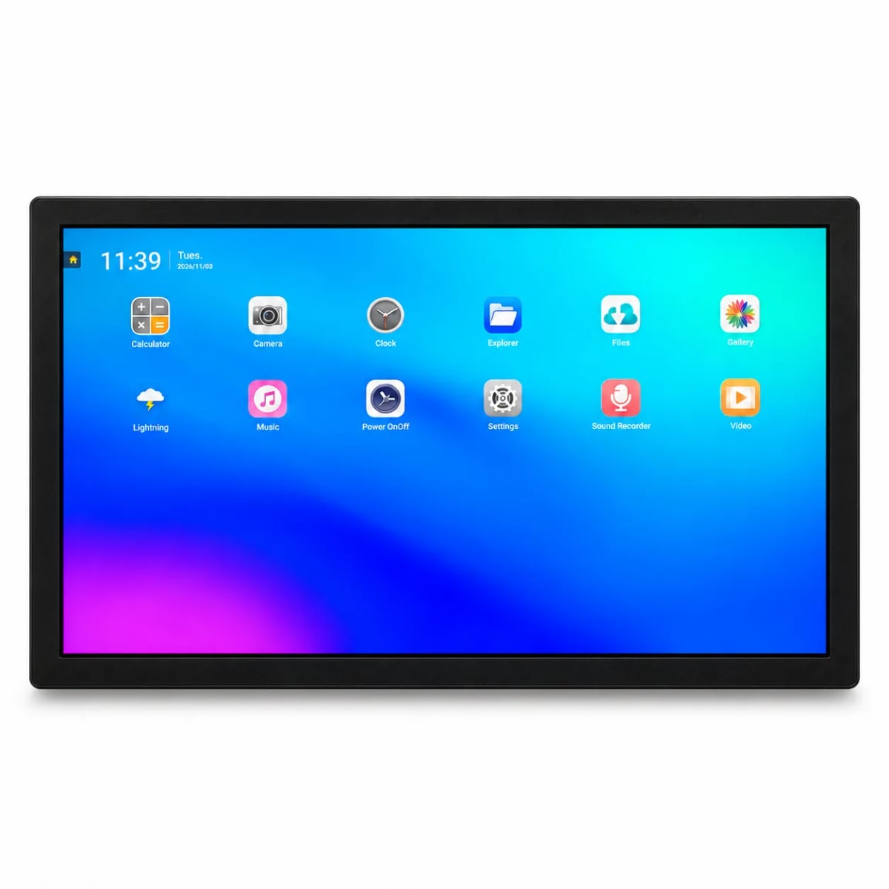
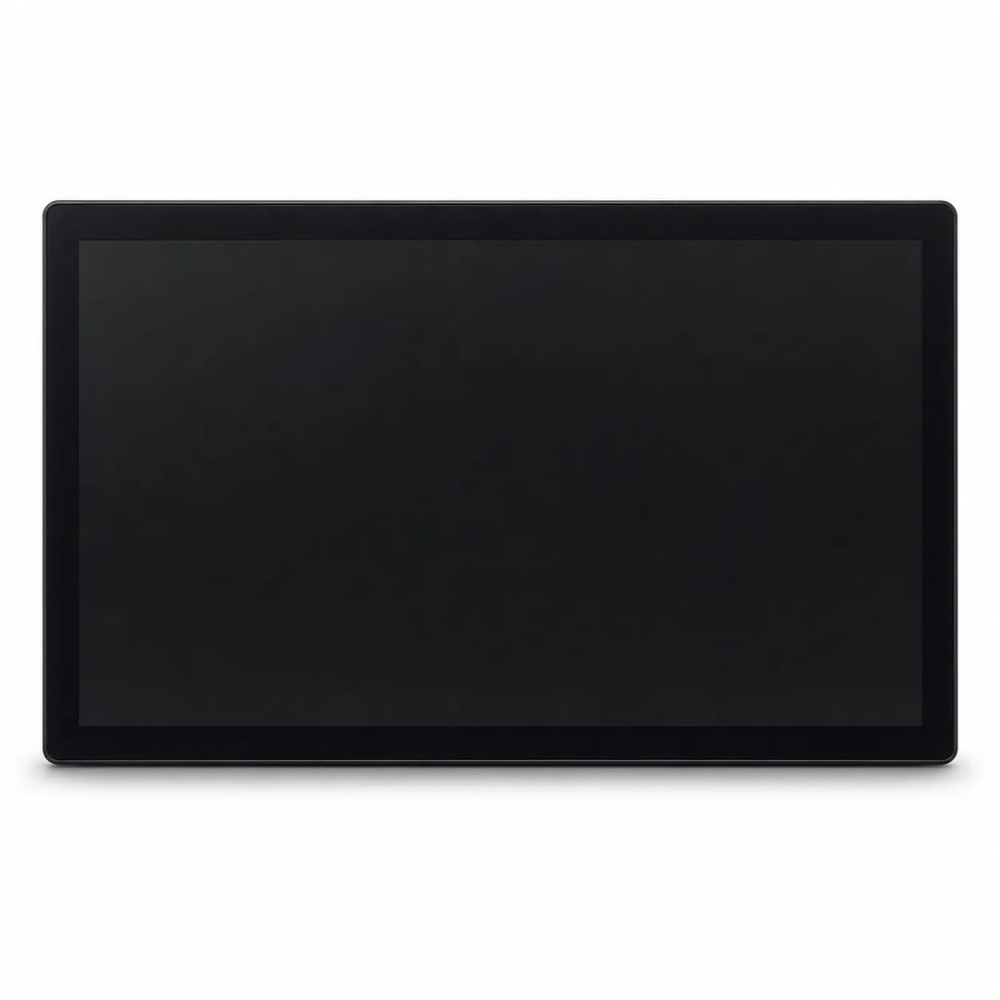
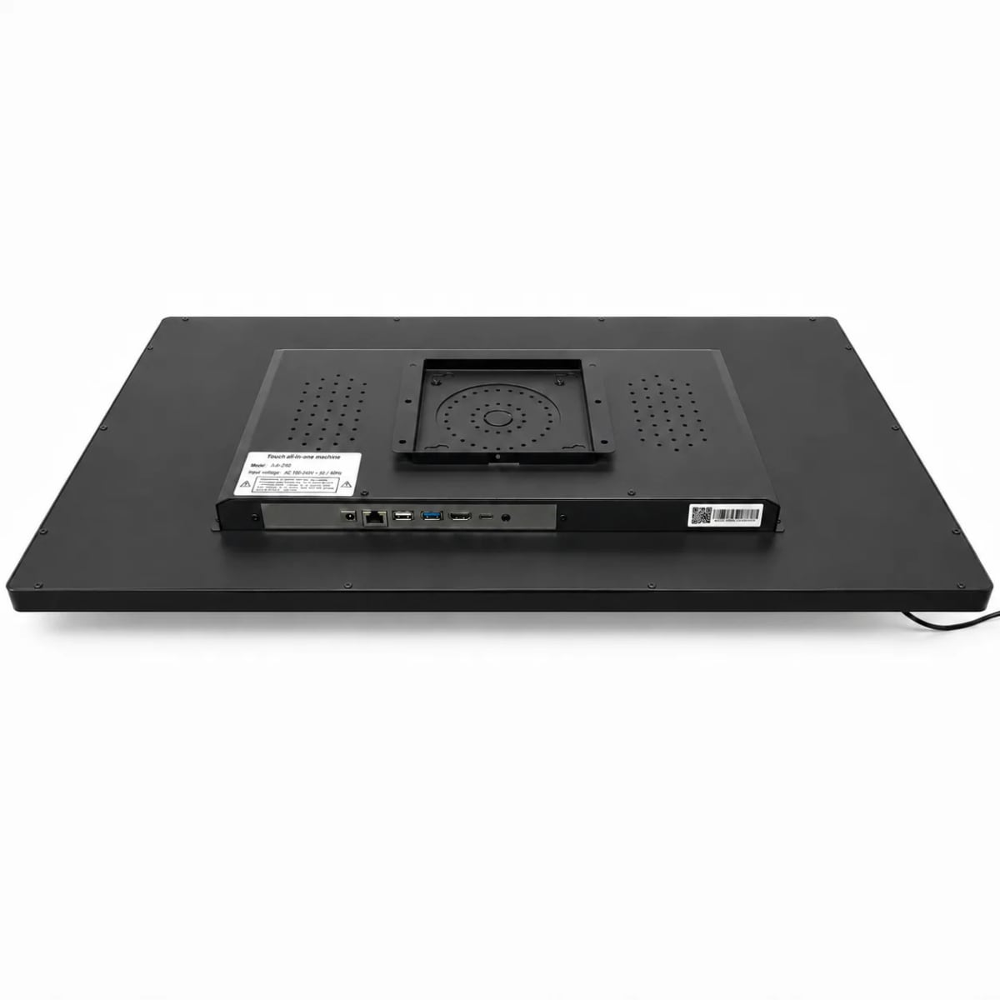
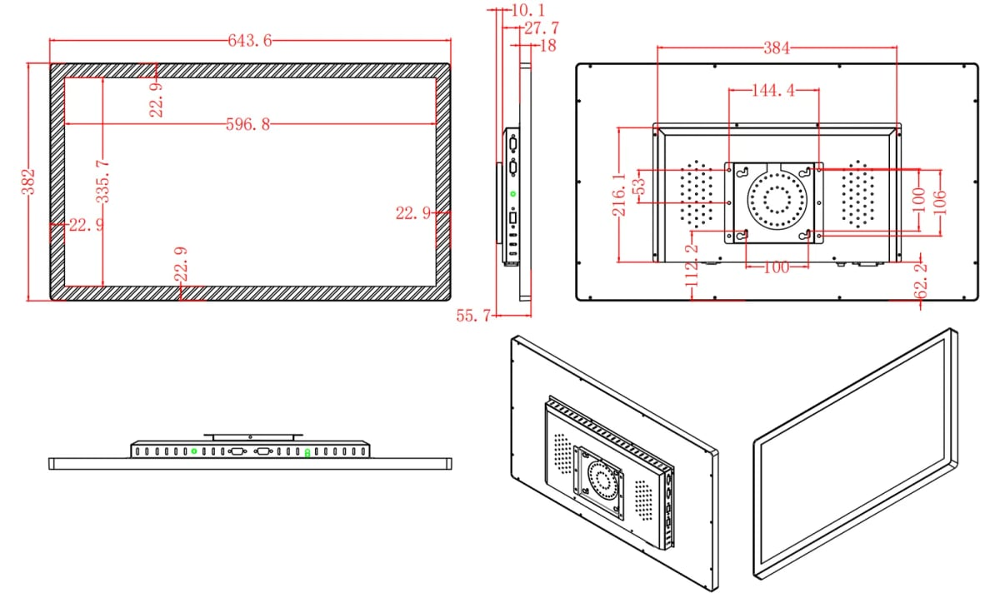
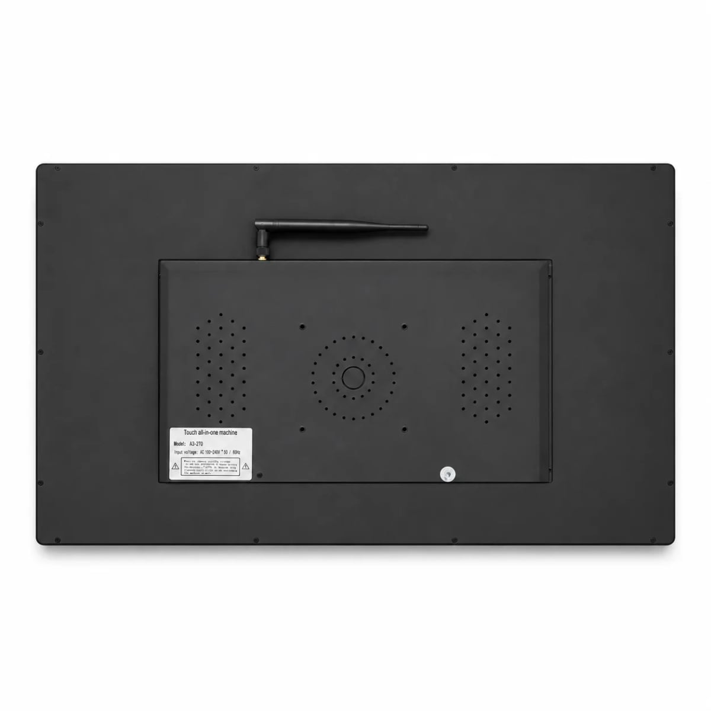
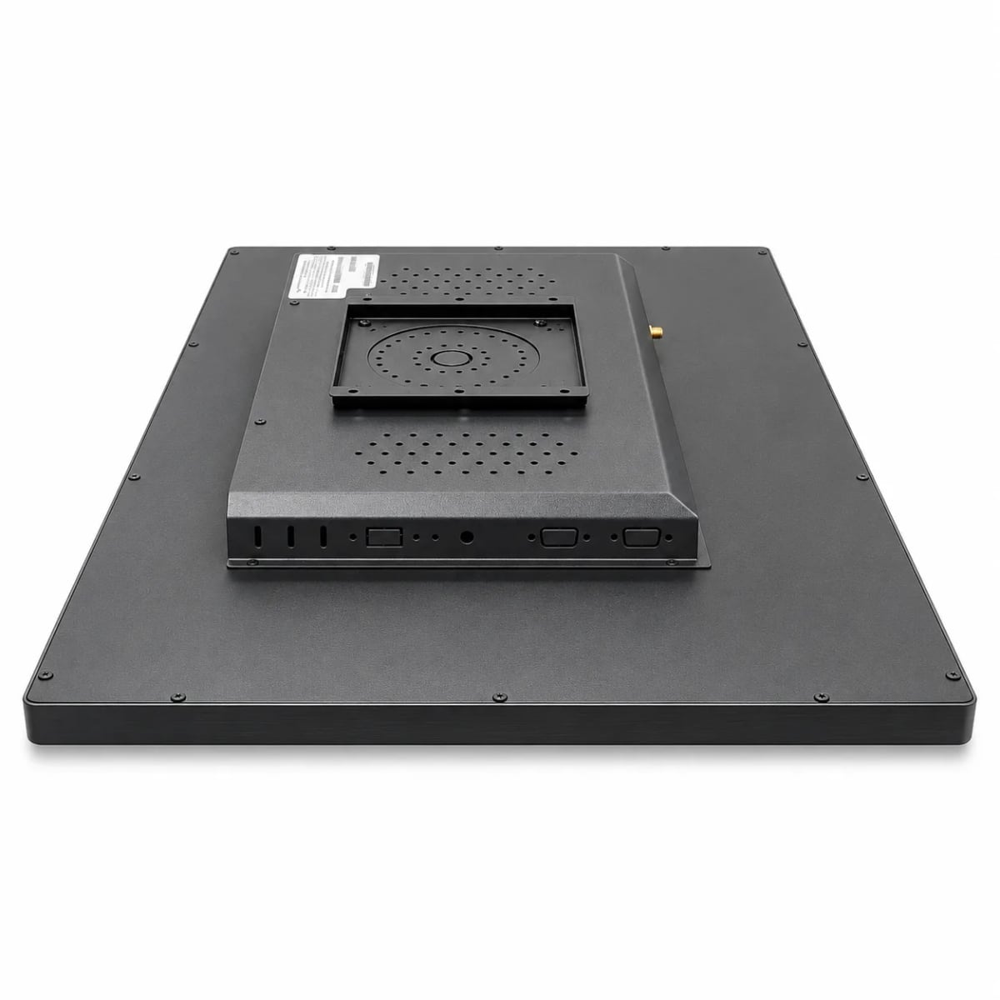
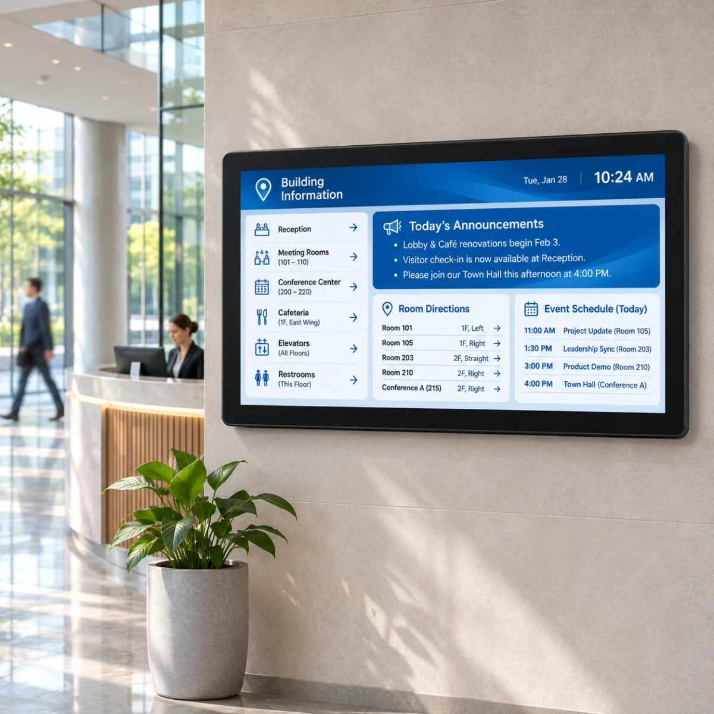

# HYY-TS-A3270-69 27 英寸壁挂式数字标牌一体机，电容触控，2560 x 1440 IPS 显示屏

> 型号: **HYY-TS-A3270-69** · 品牌: EELLNET · [在官网查看](https://www.eellnetsignage.com/zh/products/interactive-kiosk/hyy-ts-a3270-69-wall-mounted-digital-signage-kiosk?utm_source=github&utm_medium=referral&utm_campaign=products)

HYY-TS-A3270-69 是一款 27 英寸壁挂式数字标牌一体机，采用 2560 x 1440 IPS 面板，配备电容触控面板，并运行 Android 操作系统。其 RK3576 处理器、4GB 内存和 32GB 存储可在设备本地运行内容，HDMI、USB 和 RJ45 接口可连接播放器、存储设备和有线网络。EELLNET 在深圳生产该产品并支持 OEM/ODM 定制，整机提供 1 年保修。

## 产品亮点

- **2560 x 1440 IPS 面板** — 27 英寸 16:9 IPS 面板分辨率为 2560 x 1440，亮度 300 nits，对比度 1000:1，可视角度 178/178 度，即使观看者站在侧面，画面依然清晰。
- **电容触控操作** — 面板表面覆盖电容触控层，内容可直接在 27 英寸屏幕上操作，无需另配控制器。
- **RK3576 处理器运行 Android** — 四核 Cortex-A53 加四核 Cortex-A72 处理能力，配合 4GB 内存和 32GB 存储运行 Android 操作系统，为集成商开发自有内容应用提供基础平台。
- **壁挂安装，厚度 55.7 mm** — 机壳尺寸为 643.6 x 382 x 55.7 mm，采用壁挂安装设计，使屏幕下方的空间保持通畅。
- **支持本地播放器与有线网络的接口** — HDMI x1、USB3.0 x1、USB2.0 x1、RJ45 x1、3.5 mm 耳机接口和 DC12V 输入，满足本地播放、有线网络连接和音频输出需求；内置两个 5W 扬声器。
- **1 台起订的 OEM / ODM** — 可定制主板、芯片、内存、存储、触控、扬声器、外壳颜色与尺寸、操作系统与开机画面、包装以及您的 logo。批量生产前可先下样品单，最小起订量为 1 台。

## 规格参数

| 参数 | 数值 |
|---|---|
| 屏幕尺寸 | 27 inch |
| 分辨率 | 2560*1440 |
| 屏幕比例 | 16:9 |
| 面板类型 | IPS |
| 亮度 | 300 nits |
| 对比度 | 1000：1 |
| 可视角度 | 178/178 ° |
| 触摸类型 | 电容触摸 |
| 操作系统 | 安卓 |
| 处理器 | Quad-core Cortex-A53 + Quad-core Cortex-A72, RK3576 |
| 内存 | 4GB |
| 存储 | 32GB |
| 喇叭 | 2*5W |
| 接口 | HDMI×1, USB3.0×1, USB2.0×1, RJ45×1, 3.5mm earphone, DC12V input |
| 电源 | DC12V-5A input |
| 整机尺寸 | 643.6x382x55.7 mm |
| 安装方式 | 壁挂 |
| 工作温度 | 0~40 ℃ |

## 应用场景

- **零售** — 在门店中，设备可壁挂安装在商品区附近，通过 2560 x 1440 面板展示产品系列、促销活动和门店公告。顾客可用电容触控层自行打开所需页面，员工在解答基础问题上的时间因此减少。
- **快餐店（QSR）** — 在快餐店，屏幕可安装在点餐台处或其后方墙面，用于展示菜品列表和当日优惠。300 nits 面板与 178/178 度可视角度让整个点餐台范围内都能看清列表，员工可通过电容触控层或随附遥控器切换内容。
- **诊所** — 诊所和健康中心可在候诊区使用该屏幕显示排队号码、营业时间和公告。由于正面为电容触控面，且内容运行于 Android，同一台设备还可作为简易签到或导览屏使用。
- **楼宇大堂与接待区** — 在楼宇大堂和接待区，屏幕可安装在入口旁，通过 2560 x 1440 面板展示租户名录、营业时间和公告。RJ45 接口可为设备提供有线网络连接。

## 产品详情

### 正面视图：纤薄边框与纯黑触控面

HYY-TS-A3270-69 的正面是一块 27 英寸黑色面板，边框纤薄，图中屏幕处于熄屏状态。面板内部为 IPS 面板，分辨率 2560 x 1440，16:9 显示比例，亮度 300 nits，对比度 1000:1；178/178 度可视角度可让不在屏幕正前方的观看者也能看到均匀的画面。

### 侧边接口：HDMI、USB、RJ45 与音频

从倾斜的背面视角可以看到位于机壳侧面的接口区：HDMI x1、USB3.0 x1、USB2.0 x1、RJ45 x1、3.5 mm 耳机接口以及 DC12V 输入。接口集中排布，设备上墙后布线更简便。

### 后置安装板，位于两个 5W 扬声器之间

背面视图显示，安装板固定在两个扬声器网罩之间；这块安装板即为设备的壁挂安装点。两个内置 5W 扬声器让一体机无需额外硬件即可为公告和视频内容提供音频输出。

### 尺寸：643.6 x 382 x 55.7 mm

尺寸图展示了设备正面、侧面和背面布局。机壳尺寸为 643.6 x 382 x 55.7 mm，工作温度范围为 0~40 ℃。

## 常见问题

**HYY-TS-A3270-69 的显示规格是什么？**

采用 27 英寸 IPS 面板，分辨率 2560 x 1440，16:9 显示比例，亮度 300 nits，对比度 1000:1，可视角度 178/178 度。

**该一体机提供哪些接口？**

HDMI x1、USB3.0 x1、USB2.0 x1、RJ45 x1 以及 3.5 mm 耳机接口。电源输入为 DC12V-5A。

**能否定制？最小起订量是多少？**

可以。OEM/ODM 定制范围包括主板、芯片、内存、存储、触控、扬声器、外壳颜色与尺寸、操作系统与开机画面、包装以及您的 logo。最小起订量为 1 台，也可先下单样品确认品质。

**交期和保修是怎样的？**

旺季交期约一个月，淡季为 15 个工作日内，深圳 EXW。整机提供 1 年保修。

**产品如何包装？箱内包含哪些物品？**

产品采用珍珠棉保护并装入加固纸箱，配件单独包装。箱内包含 1 x 数字标牌显示屏、1 x 电源线、1 x 遥控器（如适用）、1 x 安装配件包（选配）和 1 x 用户手册。签收前请检查包裹，如有损坏请在 48 小时内反馈。

## 图片

  

## 联系我们

- **邮箱**: [info@eellnet.com](mailto:info@eellnet.com)
- **电话**: +86 177 5783 8687
- **WhatsApp**: [+86 177 5783 8687](https://wa.me/8617757838687)
- **地址**: 深圳市宝安区西乡街道南昌社区南昌路62号14栋704

---

[English](README.md) · 产品资料来自官网: [www.eellnetsignage.com/zh/products/interactive-kiosk/hyy-ts-a3270-69-wall-mounted-digital-signage-kiosk](https://www.eellnetsignage.com/zh/products/interactive-kiosk/hyy-ts-a3270-69-wall-mounted-digital-signage-kiosk?utm_source=github&utm_medium=referral&utm_campaign=products)
